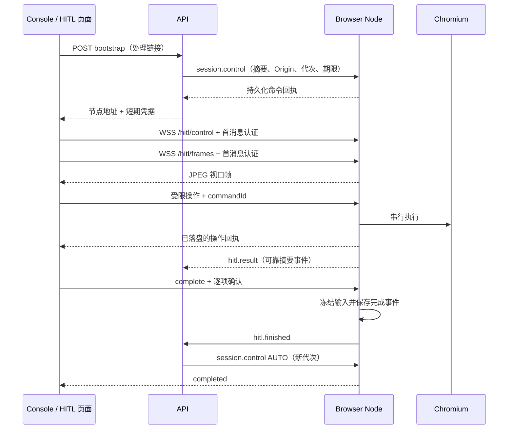

# 独立人工处理页

带 executionPlan 的新任务分别维护 controlRevision 和 authRevision：前者拒绝交接前的旧动作，后者绑定身份确认。只读画面、滚动和请求/恢复控制权不改变认证版本；人工点击、输入、导航、Cookie 变更和身份准备在命令首次获准时增加版本，重复 commandId 不重复增长。

新 Agent 的环境交接提供与待办对应的稳定 conditionKeys。处理页 complete 同时提交序号和 confirmedConditionKeys；服务端核对完整集合，保存确认时的 authRevision。同版本确认可跨交接复用，版本变化后旧确认仅作历史。处理页输入后清空勾选，要求操作完成后重新确认。待办提前包含适用的身份条件及访客复核；固定 policyChecks 不能由人工勾选替代。旧任务继续兼容不带条件键的协议，管理员直接恢复不产生稳定确认。

HITL 从管理员操作面板迁移为任务专属页面。处理者无需登录 ProofRun，只看到本次待办和当前浏览器画面；链接本身是短期操作凭据。没有 Spec Runtime，人工不修改上层验收标准，也不能直接生成 PASSED。

## 使用流程

1. 上层任务设置 `environment.allowIntervention: true`。调度器只选择具有 `liveView` 能力的 Browser Node。
2. 当前步骤明确要求已登录账号且可见页面仍有登录表单或登录页人机验证时，执行器会在模型操作前主动请求人工。每步最多自动触发一次；访客、退出登录、仅检查登录页的步骤不会触发。未授权介入时明确受阻；已授权的人工等待暂停执行时钟。其他场景执行 Agent 使用 `verification.intervene` 提供 `reason` 和可选 `items`；管理员也可在任务详情请求介入。未传 items 时使用原因作为单项待办。
3. API 在同一事务中进入 REQUESTED、生成介入记录和专属链接。原 worker 到达无在途命令的安全点后确认 HUMAN。
4. 控制台点击“打开独立处理页”；也可把处理链接交给处理者。页面没有平台导航、任务列表、报告列表或管理凭据输入。
5. 处理者点击画面、输入、滚动或使用按键完成登录和其他事项。中文/粘贴可使用页面的输入框。
6. 勾选待办并点击“完成，继续任务”。服务端等待已接收输入完成，保存条件确认后恢复 AUTO。保留当前浏览器，不保存或重启 profile；Agent 重新观察并核验条件。
7. 页面尝试自动关闭；浏览器不允许关闭时显示完成页。这里关闭的是人工处理 tab，原浏览器 session 保留到验证任务结束。

仅关闭处理页不会恢复 Agent。有效期内可用同一链接重新进入；输入不自动重放。同一时间只允许一个处理连接，另一处理页会被拒绝。输入结果未知时停止后续操作，遵循已有任务故障和资源回收规则。

## 通过 Cookie 完成本次登录

独立处理页的“通过 Cookie 登录”支持逐项输入已授权账号的名称和值。写入的是本次任务原浏览器会话，权限只在 HUMAN 状态和当前控制代次有效；Agent、只读观看页、过期链接均不能写入。目标 origin 固定为任务目标站点，不允许改写其他站点或指定任意 domain。

Cookie 使用 host-only、根路径 `/`、SameSite=Lax 和会话有效期，HTTPS 站点启用 Secure。默认 HttpOnly；站点前端需要读取时可取消。输入必须是有效的 Cookie 名称和值，不接受整段 `Cookie:` 请求头或任意脚本；多项可逐个提交。写入不消耗 Agent 动作预算，仍受串行队列及 commandId 去重约束。等待操作确认后再完成接管；不确定结果不自动重放。

默认勾选“写入成功后刷新远端页面”。组合操作整体入队，仅在写入成功回执后刷新；失败、断线或未知结果不会继续刷新，也不自动重放。多项 Cookie 可在最后一项勾选刷新。人工刷新不消耗 Agent 动作预算，仍有单条命令超时。

当前步骤要求登录时，无论模型介入发生在登录表单还是只有登录入口的业务页，恢复后 Agent 保留人工处理后的当前页面，重新采集证据并核验身份；只有步骤明确更换入口时才导航；Cookie 写入成功不等于登录或业务验收成功。人工处理只作用于当前会话。Cookie 功能需要 Browser Node 支持 `browser.cookies.set`；新增导航和刷新复用现有节点协议。

Cookie 值不进入 CLI 参数、操作回执、活动摘要或模型工具上下文；原始人工命令仍按现有命令持久化和保留策略存储。填写区使用密码输入，提交后清空，不写入 URL 或前端持久存储。

## 远端导航与操作焦点

独立处理页提供“前往远端网址”和“刷新远端页面”，复用当前任务会话。地址框表示人工输入的目的地，不是远端实时地址栏；仅允许不含账号密码的 HTTP/HTTPS URL。服务端仅开放 navigate/reload，不开放任意 browser.act 或脚本。导航与刷新遵守原控制代次、单会话串行、命令去重与单条命令超时；Cookie 写入范围仍固定为任务 origin。

获得 HUMAN 控制权后，导航和刷新无需等待首帧；坐标输入仍需画面。首帧等待超过十秒时提示加载超时，十五秒仍无首帧则自动重新授权连接；控制握手十秒未确认也会重连。连续失败按 1、2、4、8、15、30 秒退避，仍失败则保留手动重连入口；授权失效立即停止重试。操作回执等待期间禁止主动重连，断线与超时会清空输入队列，重连不会重放旧操作。人工等待状态每秒轮询，续期守卫独立运行。状态读取不取得执行写锁，迟到的单条续期拒绝或回执超时不直接终止会话；节点本地租约真正到期、worker 失联或任务终止时仍撤权。Agent 不允许旧状态快照回退已确认的租约，也不能在租约到期后复活。

点击或键盘聚焦画面后，浏览器区域出现蓝色轮廓和“键盘输入将发送到远端”提示。点击外部、“退出键盘控制”、切换窗口或页面隐藏会解除提示；不在全局捕获键盘。轮廓不占内容尺寸，不改变坐标映射。

左侧显示处理链接剩余有效期，最后一分钟突出提示，链接到期后禁用操作。链接失效不会结束等待中的任务，可从任务详情重新获取链接；旧链接失效且不能随更新重新生效。已经取消、失联或关闭的会话不能因此复活。

## 当前会话与人工终态

人工修改只作用于本次临时浏览器。完成后保存确认事项并交还控制，不导出登录快照、不发布完整 profile、不重启浏览器。身份与资格仍受 setup 门禁和认证代次约束；人工确认不代替业务验收。

无法处理须填写原因，终止当前 Case 未完成执行并保留已有证据。旧链接仍可查看最终处理结果。后续任务使用新的访客／人工会话或重新申请 DevPass 材料，旧登录槽位不会被恢复。

## 接口和授权

任务页通过已认证的 `GET /v1/admin/executions/:id/intervention`（或执行者对应入口）取得 `/#/hitl/<id>/<token>`。处理链接有效四小时，仍受任务、人工等待、外部账号期限和短租约约束。过期链接只能由任务页重新签发；轮换身份后旧链接失效。

处理页把链接凭据放在 `POST /v1/hitl/bootstrap` 请求体中。REQUESTED 时只轮询等待；HUMAN 且节点确认交接后，API 生成一分钟内可连接的随机凭据，通过可靠 `session.control` 命令把摘要和授权范围安装到节点，等待节点回执后返回直连地址。原始链接、管理员密钥及机器凭据都不会发给节点直连客户端。响应禁止缓存，令牌不放进 URL 或查询串。

客户端在首条 `authenticate` 中携带 bootstrap 返回的 `nodeId`、介入 ID 和短期凭据。显式绑定按 nodeId 选择唯一控制面范围，控制面不能向未获节点拥有者批准的 Console Origin 签发授权。节点验证 WebSocket Origin、首条 `authenticate` 消息、令牌摘要、介入身份、控制代次与会话短租约。控制凭据只消费一次，每个会话只有一个人工控制连接；媒体连接必须依附该控制连接。重连重新向 API 换取凭据，旧连接退出不会撤销新连接。



人工“无法处理”同样先保存可靠事件，再由 API 终止 Case。完成期间断线后只查询结果，不重放输入。取消、租约失效、节点重启或控制代次变更会撤销直连。

## 节点与实时通道

客户端通过节点公开 HTTPS 域名连接本机代理，再到 Node 回环监听。`/hitl/control` 传输入和回执，`/hitl/frames` 传人工画面；只读 Live 使用单独的 `/live/frames` 和只读凭据，不能取得输入权。API 只负责授权和持久状态，不持有媒体 socket 或最后帧缓存，也没有 `/v1/hitl/connect`、`/v1/hitl/relay`、`/v1/live/connect`、`/v1/live/relay` 入口。

节点使用固定 agent-browser 0.38.1 的本机 streaming 服务，最多请求 8 帧/秒，单帧限制 2 MiB。发送完成后向本机流 ACK；网络发送超过三秒则断开，控制消息不会排在媒体连接后。流只传视口图像，不公开 CDP、引擎 dashboard、标签列表或任意引擎消息。画面不写入 SQLite outbox 或报告证据库；断线时最后一帧仅在当前页面内存保留，并标明正在恢复；收到新帧前禁用画面输入，终态清除画面。

输入允许 `browser.input`（click/text/press/scroll/drag）、HTTP(S) 导航/刷新、目标站点同源 Cookie 写入；不接受任意脚本、会话管理或分组切换。人工和自动操作共用会话串行许可；SQLite 以完整命令身份去重，先保存结果再回应客户端。人工输入不消耗 Agent 动作预算，可能影响身份的首次操作递增 authRevision，重送不递增。API 只持久化不含输入值的操作摘要，节点账本保存命令哈希和回执摘要，原始输入仅用于当前操作。

人工拖动在画面中按下、移动并松手后，以单条 `drag` 命令提交完整轨迹，节点按原节奏派发左键按下、移动和释放，画面随后更新。轨迹最长 8 秒、最多 256 点；失焦、取消、断线或画面尺寸变化会丢弃尚未提交的手势。节点失败时尝试松开鼠标，未知副作用仍按现有机制关闭会话，不重放拖动。此能力只转发人工操作，不判断验证码位置或是否通过。

控制和画面通道各自每十五秒发送协议级 Ping，四十五秒未收到对应 Pong 则关闭失联连接。此心跳用于经过代理的空闲连接保活，不续期任务权限；静态页面没有新帧不代表失联。

初始视口同步为 1280×720。页面按 JPEG 比例显示并映射坐标，输入仍走受限的原生 mouse/keyboard 命令。客户端输入超过 25 秒、交接超过 150 秒未确认时显示重连入口；未确认操作不会自动重放。

域名配置与迁移顺序见 [部署说明](../deploy/README.md#节点直连域名与升级)。本地 Console 分端口时设置 API 的 `PROOFRUN_CONSOLE_URL`，该 origin 同时绑定直连授权；生产节点必须使用客户端可达的 HTTPS 地址。

## 验证

```sh
pnpm check
PROOFRUN_TEST_DATABASE_URL='<独立测试库>' pnpm test:api
PROOFRUN_TEST_DATABASE_URL='<独立测试库>' pnpm test:agent:integration
PROOFRUN_TEST_AGENT_BROWSER=/absolute/path/agent-browser-linux-arm64 pnpm test:hitl:linux
```

新增 API 集成场景覆盖：非法链接、越权读取拒绝、单处理者、等待交接、客户端直连画面、拒绝会话管理命令、输入去重与人工/Agent 预算隔离、断线重进、完成撤权、新旧介入隔离和取消失效。模型请求人工与恢复后的报告仍由 Agent/API 集成覆盖；这些测试中的模型和节点是协议夹具。

浏览器页面联调使用独立临时数据库，确认无需平台登录、仅显示当前待办和画面、提交输入、完成页及交接。内嵌浏览器限制自动关页，页面提供完成页回退，不能保证所有浏览器均能自动关闭。

Linux 测试使用真实 Rust Node、systemd、agent-browser 和 Chromium，检查真实 JPEG 帧、坐标点击、中文与前导短横线输入、按键、业务提交次数、完成后原 session 仍可观察和最终关闭。模型/执行者是夹具，回环连接用 WS，不代表生产 TLS、真实内网、业务 SSO/MFA 或真实模型验收。

测试镜像固定 Rust 1.98.0，避免浮动补丁版本隐式触发下载。网络受限时可显式使用缓存镜像、工具链和只读 Cargo registry，测试日志会输出实际 cargo 版本：`PROOFRUN_TEST_SKIP_IMAGE_BUILD=true`、`PROOFRUN_TEST_RUST_TOOLCHAIN=1.98.1`、`PROOFRUN_TEST_CARGO_REGISTRY=/absolute/path/to/registry`。默认不启用这些覆盖。

当前提供网页视口的点击、文字、按键和滚动；不包含操作系统桌面、文件选择器、拖拽或远端浏览器标签管理。业务弹窗、多标签 SSO 等场景需要单独验证，不能从普通登录夹具推断全部支持。

## 控制权与执行代次

`AUTO → REQUESTED → HUMAN → AUTO` 是同一次执行的控制权状态，不是新的任务生命周期。管理员和模型均只能为 `environment.allowIntervention: true` 的任务请求人工辅助。REQUESTED 立即阻止新自动操作；worker 等在途命令完成，在安全点确认后进入 HUMAN。管理员恢复或本次处理者提交完成后，由 API 发出新的 AUTO 代次并等待节点确认。

暂停和恢复都更新 controlRevision。命令及报告绑定该代次；旧页面不能在新的人工会话里操作，旧模型回复不能在人工改动后继续执行。REQUESTED/HUMAN 暂停任务执行时限，使用独立人工等待期限（默认三十分钟）；原 worker 和节点仍须持续续租，失联、取消和节点故障继续按原规则回收。

新 v2（stepBudget.version=1）暂停业务计时，恢复只补回实际等待时间，继续本步剩余额度；模型与动作计数不清零，清理三分钟墙钟不暂停。以下二十分钟重置规则只适用于旧任务。首次执行仍使用提交时的预算。用户完成处理后，控制面在同一事务恢复 AUTO 并把整体任务截止时间设为当前时间加二十分钟；重复提交同一恢复操作不会再次加时。Agent 从心跳及执行视图同步新截止时间，并忽略旧代次的迟到回复。完成后重新观察、重新判断；后续再次介入时同样暂停，再次完成时重新获得二十分钟。`maxActions` 只限制 Agent 的自动动作；HITL 点击、输入、滚动、导航和 Cookie 写入没有该次数上限，也不消耗 Agent 额度。Agent 已消耗次数不因人工完成而清零，单条命令超时与串行约束仍生效。

直连版本需要同步升级 API、Console 与 Browser Node；旧节点没有资源准入声明，不能领取新任务。迁移会从命令记录校准活动执行的 Agent 动作计数，不改写已结束的历史报告。

暂停时限规则需要同步部署 API、Agent 和 Console，并发布、升级 Browser Node。允许人工介入的任务仅分配给声明 `renewableSessions` 能力的新节点：其浏览器会话及 systemd 进程不再绑定初始任务时限，持续受短租约、宿主失联和取消回收约束；普通任务仍保留固定会话时限。旧节点不会领取人工介入任务，旧 Agent 仍会按领取时的固定期限停止，因此应在服务和节点均升级就绪后创建任务。

Console 提供观察/截图、导航、点击、填写、按键和滚动；不提供任意脚本、shell、CDP 地址或直接会话续租。页面操作不能更改验收项，人工也不能直接写入 PASSED 结论。命令输入和 DOM 可能含业务内容，管理员接口仍需部署在受控入口；身份材料不进入模型上下文。

## 旧快照入口

`browser.auth.save`、节点模板维护、登录快照恢复已经退役。旧记录与本地基准文件保留，新的人工完成不产生这些文件。只依赖旧基准的身份需重新提供 Cookie 或外部账号来源。

## 环境准备中的条件交接

业务 setup 按未解决条件分配人工交接机会：登录缺失与原始 workflow/preconditions 条件分别记录，同一条件只交接一次，单次执行最多三轮。用户完成登录不代表角色、第三方绑定或页面前置条件已满足，返回后仍重新核实；新发现的未解决条件可继续交接，重复失败或额度耗尽时保留具体原因及阻塞截图。环境未 ready 时阻止全部后续步骤，包括 cleanup；仅关闭浏览器会话回收资源，不自动退出业务账号或清 Cookie。任务终态展示阻塞现场，历史清理截图单独展示。

新 profile 分组任务的人工请求会先定位求助组 tab，再暂停同 profile 所有组。处理页 complete 消息须携带 confirmedItems，明确确认本次待办；这些确认随控制代次保存，管理员 resume 不生成确认。恢复后活动组重查自身 policy。环境未就绪只跳过本组验证，并禁止整个 profile 的 cleanup；其他组继续。历史任务保留整链门禁。
