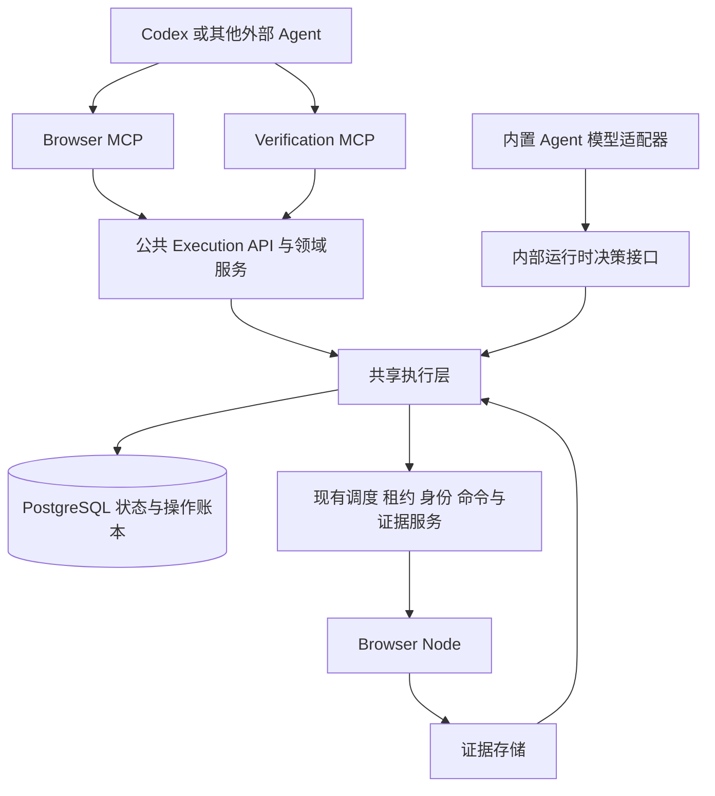

# ProofRun 双 MCP 与外部验证执行设计

本设计将浏览器任务与验证任务分别暴露为 `proofrun-browser` 和 `proofrun-verification`，共用控制面、Browser Node、身份来源、执行状态机和证据存储。上游既可委托内置 Agent 执行，也可由 Codex 等外部 Agent 逐步操作平台浏览器，并交付正式 Case 报告。

状态：双 MCP 的任务级和操作级工具、共享执行层及外部直接执行 HTTP API 均已实现；两套端点各 16 个工具。当前参数以 [API README](../apps/api/README.md#mcp-操作工具与-codex-执行流程) 和 tools/list 自包含契约为准。下面保留架构约束及设计依据；真实 Codex CLI / Chromium 已在独立 Linux/systemd 环境完成一次完整 Case 联调，见 [可复跑入口与验收边界](../tests/mcp-real/README.md)；DevPass 与生产站点仍需单独环境验收。

## 1 设计决策与范围

| 决策               | 具体约定                                                                                               |
| ------------------ | ------------------------------------------------------------------------------------------------------ |
| 两套 MCP           | 同一 API 服务提供 `/mcp/browser` 与 `/mcp/verification`，工具目录和授权范围独立，不拆数据库与节点池    |
| 两类任务           | `browser` 交付目标完成情况与正文；`verification` 交付冻结验收标准的逐项结论与证据                      |
| 两种执行主体       | `executor.kind = builtin \| external`，创建运行时冻结；它不替代历史 `executionMode: llm`，也不恢复 JEV |
| 一套执行规则       | 内置 Agent 与外部 Agent 都通过共享执行层处理阶段、预算、观察、进度、命令和完成条件                     |
| 一轮一个控制者     | 运行绑定一个调用方和一个控制句柄；第一版不支持内置与外部执行者中途切换                                 |
| 外部执行先串行     | 外部验证第一版同一运行只有一个活动组和步骤；组仍有独立 tab，不合并成一条跨组依赖链                     |
| 正式报告由平台生成 | 外部 Agent 只提交当前原始要求的完成声明、验收项结论和证据引用，不能提交最终报告对象                    |
| 受控浏览器 API     | 提供观察和受限操作；不开放原始 CDP、任意 JavaScript、shell、节点管理或原始身份材料                     |
| 无隐式业务恢复     | MCP 断线可在有效期内重连；服务故障后不盲目重放动作，第一版不承诺恢复到中间业务步骤                     |

不包含：需求分析、自动生成或降低验收标准、跨 Case DAG、业务资源锁、完整请求与响应正文取证、多租户、跨执行者接管、任意 Cookie 导入、Playwright 脚本托管。网络隔离继续由部署环境负责，`entry` 或步骤 URL 仍不自动成为导航白名单。

### 1.1 当前可复用的实现

| 现有位置                                          | 可复用内容                                          | 必须补齐的边界                               |
| ------------------------------------------------- | --------------------------------------------------- | -------------------------------------------- |
| `apps/api/src/modules/cases/structured.ts`        | Case 编译、稳定步骤与验收项身份、预算与 profilePlan | 无副作用预检、执行主体冻结、预览响应         |
| `apps/api/src/modules/cases/v2.ts` 与 `requests/` | 幂等提交、运行历史、请求关联和原子重跑              | 明确来源运行的重跑、提交回执快照、调用方授权 |
| `apps/api/src/modules/scheduling/coordinator.ts`  | 调度、执行授权、命令去重、控制代次、关闭            | 外部执行准入、控制绑定与存活约束             |
| `apps/agent/src/execution/`                       | setup 门禁、步骤编排、进度账本、预算、恢复边界      | 从模型循环抽离，并迁移到共享服务持有权威状态 |
| `apps/agent/src/evidence/`                        | 观察校验、证据范围、网络视图                        | 面向 MCP 的有界投影与资源读取                |
| `apps/api/src/modules/reports/`                   | 证据归属、摘要校验、报告一致性                      | 外部执行来源及未知用量表达                   |
| `/v1/browser-tasks`                               | `taskId / url / objective` 委托执行                 | 当前没有直接控制会话，也不支持新版身份参数   |

现有 worker 的 claim、heartbeat、commands、steps、complete 和 artifacts 接口属于内部协议，不能直接作为第三方稳定 API。尤其是当前 Agent 内的条件核验和完成账本不能通过只包装 commands 接口得到。

## 2 系统结构与职责



MCP 和 HTTP 是同一应用服务的两个适配器，MCP 不通过本机 HTTP 再绕一遍管理员接口。两者复用同源 Schema、错误映射、幂等处理和授权；HTTP 便于其他客户端集成及协议测试。运行状态不依附于 MCP 连接，断开 SSE 或客户端工具调用超时不等于取消运行。

内置 Agent 保留模型配置、提示词、工具映射、供应商请求与用量采集。共享执行层负责执行事实和状态转换，不发起隐藏模型请求。人工登录和环境处理继续使用现有 HITL，外部 Agent 不冒充人工确认。

## 3 公共契约

以下参数表中 `?` 表示可省略；未标记的字段必填。请求拒绝未知字段。新协议的机器标识和 JSON 字段使用英文，说明和代码注释使用中文。

### 3.1 身份与幂等

| 字段                         | 生成方与作用                                                                                               |
| ---------------------------- | ---------------------------------------------------------------------------------------------------------- |
| `requestId`                  | 调用方生成，1–80 位字母、数字、下划线、短横线；一次验证请求的幂等身份                                      |
| `caseId`                     | 复用 v2 业务 Case 身份；同身份不同定义冲突                                                                 |
| `runKey`                     | 调用方生成的重跑幂等键，同上字符约束；v3 使用此名称以区别运行身份                                          |
| `runId`                      | 服务端返回的实际运行身份，不透明字符串；客户端必须原样使用，不能由 `runKey` 拼接                           |
| `taskKey` / `sessionKey`     | 调用方生成的浏览器委托任务或直接会话创建幂等键，同上字符约束                                               |
| `sessionId`                  | 公共浏览器会话身份，不是节点内部会话凭据                                                                   |
| `controllerId`               | 服务端绑定外部执行者后返回的控制句柄，绑定调用方、运行与会话，关联服务端当前控制代次；本身不是 Bearer 凭据 |
| `operationId`                | 调用方生成 UUID；除创建操作外，所有改变状态或采集新观察的公共操作都要求携带                                |
| `stepId` / `criterionId`     | 来自冻结 Case 与编译结果，不允许执行者临时新增                                                             |
| `observationId` / `targetId` | 平台生成，绑定运行、tab 和观察；旧目标只能用于历史展示                                                     |
| `evidenceId`                 | 平台登记的附件身份；不能由外部 URL、上传文本或 observationId 替代                                          |

`runKey` 映射到现有重跑请求中名为 `runId` 的重试键；返回值仍使用实际 CaseResult 的 `runId`。适配器负责区别，不改写旧客户端契约。

所有创建键在同一调用方和资源种类内幂等，重复提交同键同语义输入返回首次接收回执；同键不同输入返回 409。`operationId` 在调用方范围内唯一，并绑定资源、操作种类和规范化参数摘要。查询已有幂等记录必须先鉴权；命中原记录后不因当前版本、阶段或租约已变化而再次执行。同键改参数冲突，明确失败后要尝试新的操作必须使用新键并重新读取状态。

创建回执和操作幂等记录的保留期至少覆盖对应运行的可重试生命周期；清理正文后仍保留键与资源的删除标记。重送旧键不能复活已关闭或删除的运行。参数摘要按解析后的语义对象计算，明确区分省略值与服务端默认值，冻结首次接收的配置，不能因部署默认值变化把同一请求变成新执行。

提交回执中的 `runs` 保存首次接收时的运行绑定和 `origin: created | reused`，不随请求后来重跑而改变。`verification_get_request` 返回当前请求成员及 `requestRevision`；二者不可混用。不同请求复用同一 Case 时，v3 只允许复用调用方有权访问且执行主体兼容的运行；不兼容返回 `RUN_EXECUTOR_CONFLICT`，由调用方显式重跑。旧 v2 全局身份规则不自动变为按调用方隔离，命中不可访问记录时返回不泄露详情的冲突。

### 3.2 认证与两套 MCP 的会话关联

第一版新增配置式服务凭据：服务端保存 token 摘要及稳定 `principalId`、允许的 MCP 和 scope；这是调用方级授权，不新增用户、租户或 UI 账号系统。现有管理员凭据继续服务旧 API，不直接下发给外部模型；内部 worker 和节点凭据保持独立。

建议 scope 为 `browser:delegate`、`browser:control`、`verification:submit`、`verification:execute`、`runs:read`、`evidence:read`、`runs:cancel`。接口还检查运行归属、会话归属和当前控制权，scope 不能单独授予其他调用方的运行。两个 MCP 的 token 可不同，但必须映射到同一个 `principalId` 才能共享控制句柄。`principalId`、权限、内部租约和节点身份不得从工具参数接收。

验证 MCP 的 bind 返回既有运行的 `sessionId/controllerId`，Browser MCP 只能对该绑定操作。禁止通过 `browser_session_open` 附加已有验证运行；禁止将通用浏览器会话事后提升成正式 Case 运行或跨运行引用证据。

生产使用 HTTPS Streamable HTTP。工具的只读提示用于客户端展示，不替代服务端权限。OAuth 和多调用方委派授权可后续增加，不作为内部受控接入的首版依赖。

### 3.3 共用输入类型

| 类型               | 字段与约束                                                                                                                                                |
| ------------------ | --------------------------------------------------------------------------------------------------------------------------------------------------------- |
| `Executor`         | `{kind: "builtin" \| "external"}`；submit 默认 builtin，创建运行后冻结；external 要求执行权限                                                             |
| `RunRef`           | `{runId: string}`；新接口所有结果、证据、取消按确切运行定位，不使用“最新 Case”作为写操作目标                                                              |
| `ControlRef`       | `{controllerId: string}`；服务端解出 run、session、控制者，逐请求鉴权                                                                                     |
| `Mutation`         | `{operationId: UUID, expectedRevision: integer >= 1}`；expectedRevision 是执行状态版本，与内部控制代次不同                                                |
| `StepRef`          | `{stepId: string}`；验证运行的浏览器动作和进度操作必填；通用浏览器会话禁止传入                                                                            |
| `CaseV2`           | 原样复用 `verification-case-v2.schema.json`，保留 session、policyChecks、preconditions、requiredCapabilities 和 cleanup                                   |
| `Progress`         | `{requirements?: RequirementClaim[], criteria?: CriterionClaim[], readings?: ReadingClaim[]}`，沿用当前 progress 的字段和校验；允许空对象，不接受任意扩展 |
| `RequirementClaim` | `{id,status:"complete"\|"incomplete"\|"blocked",summary,evidenceRefs:string[]}`；id 必须来自当前上下文                                                    |
| `CriterionClaim`   | `{criterionId,verdict:"PASSED"\|"FAILED"\|"INCONCLUSIVE"\|"SKIPPED",summary,evidenceRefs:string[]}`；确定结论必须满足原证据要求                           |
| `ReadingClaim`     | `{itemId:string,quote:string}`，quote 为 1–600 字符；itemId、原文和观察范围必须匹配，不把阅读记录当作业务结论                                             |

当前 browser task/session 只接受 url 和 objective，不接收 session 覆盖；沿用现有浏览器编译服务。正式验证的身份规则由 Case 冻结，manual/external 准备和门禁仍由平台处理。

`expectedRevision` 在阶段、要求/结论账本、当前观察、控制权或认证版本变化时递增；纯读取、心跳、日志追加不递增。命令接收时锁定执行并核实版本及在途命令，避免两个并发调用同时操作。状态冲突返回当前版本和重新读取入口，不自行替调用方重试。

取消不要求 expectedRevision，以便在状态变化时仍能停止指定运行；touch 和首次 bind 使用独立原子规则，也不要求该字段。重跑使用 expectedRequestRevision。除表中这些明确例外，其余控制和步骤变更使用完整 Mutation。

### 3.4 共用返回类型

工具统一返回 `{kind,data}`，错误返回 PublicError。任务回执沿用 McpTaskResult，直接执行结果沿用 ExternalExecutionResult；完整字段以 tools/list 的自包含 outputSchema 为准。

| 类型                      | 内容与边界                                                                                                                                                                                                   |
| ------------------------- | ------------------------------------------------------------------------------------------------------------------------------------------------------------------------------------------------------------ |
| 任务回执                  | submission/run/request/evidence 等任务服务投影，保持原工具兼容                                                                                                                                               |
| 直接执行 OperationReceipt | kind=operation；data 含 operationId、controllerId、runId、status、progressApplied、effect、error                                                                                                             |
| ControllerView            | kind=controller；data 含 controllerId、runId、revision、state、runState、sessionState、controlMode、idleDeadlineAt、closureVerified、pendingOperation、context、allowedActions、nextAction、executor、report |
| ExecutionContext          | context 包含 task/state/page/history/evidence/budget/feedback；使用共享执行器白名单投影，不返回租约                                                                                                          |

直接执行的操作状态为 RUNNING/SUCCEEDED/FAILED/UNKNOWN，effect 为 NOT_STARTED/OBSERVED/APPLIED/UNKNOWN。operation_get 同时查任务操作和直接执行操作；两者保留各自已有回执结构。progressApplied 表明部分合法进度可能已保存，不能因为后续动作失败就重复提交整个决定。

控制绑定 state 为 ACTIVE/CLOSED/EXPIRED/LOST，与浏览器 sessionState 和业务 runState 分开。nextAction 为 ACT/WAIT/HUMAN_REQUIRED/READ_REPORT 字符串；只有 ACT 时按 allowedActions 提交新决定。HITL 交还后必须重读上下文、版本和观察。

RunView 的 reportPhase 为 PENDING/PARTIAL/FINAL，reportStatus 为 null/PASSED/FAILED/INCONCLUSIVE，cleanup 单列。browser 的 reportStatus 和 criteriaCounts 为 null，业务结果位于 browserResult。报告分页每页默认 25、范围 1–100，并有 96KiB 上限；cursor 绑定资源、视图和报告版本，版本变化返回 CURSOR_STALE。

MCP 以 structuredContent 返回结构化结果，并提供文本内容；截图通过 evidence_read 返回原生 image。每个工具独立声明 inputSchema/outputSchema，复用固定契约并展开引用。直接执行异步返回操作回执，调用方查询 operation_get 至终态，再读取新 context；客户端连接等待不扩大动作预算。业务受阻与产品失败需从最终报告区分，不能把操作登记成功当成验证通过。

### 3.5 能力发现与预检

能力响应包含 `schemaVersion:1`、`generatedAt`、`supportedTaskKinds`、`supportedExecutors`、输入限制、身份模式、预算规则和能力条目。每条能力包含 `id`、`implemented`、`availability:available|busy|unavailable|unknown`、`reasonCodes`、`constraints`、所需节点/worker 版本、证据类型及原始采集限制。

`available` 只表示基于当前配置和心跳具备执行条件，不保证目标可达或账号最终可分配。目标网络、真实身份和业务数据未实际检查时放在 `unchecked`；不通过预检启动浏览器、申请账号或探测业务 URL。能力列表稳定，实时变化放返回数据，不因节点繁忙反复修改 tools/list。

每个可用性结论附 `source` 与 `checkedAt`；缺少可信 worker 存活、模型能力或额度信息时对应项为 unknown，不能由 `/health/ready` 或“已配置密钥”推断模型可用。对节点能力匹配使用现有调度条件，而不是全节点能力取并集后假设存在一个满足全部条件的节点。

预检复用真正提交的编译器，返回 `valid`、带 JSON Pointer 的 `errors/warnings`、`definitionDigest`、分组和身份预览、逐步预算、所需证据/能力、节点匹配摘要及 `unchecked`。预算来自服务端冻结配置；Case 文本不能自增动作或模型额度。检查会指出多 setup 分组、共享可变数据、清理门禁以及不支持的取证要求；不能证明自然语言没有遗漏。

预检结果不预留资源，也不是执行许可。submit 再编译、鉴权并核实能力；当前不引入预检令牌或隐式锁。`runtimeEvidenceV1/networkDetailsV1/focusRecoveryV1` 仍是 v2 可显式声明的能力名，新的目录名称不能直接写入该枚举。

## 4 Browser MCP 工具与参数

工具分为委托任务和直接操作两组。可按调用方 scope 隐藏不授权工具；运行时 allowedActions 仍由服务端逐次核实。

### 4.1 创建与生命周期

| 工具                       | 输入                                                                          | 返回和行为                                                                                               |
| -------------------------- | ----------------------------------------------------------------------------- | -------------------------------------------------------------------------------------------------------- |
| `browser_get_capabilities` | `{url?:httpUrl}`                                                              | 能力目录；不进行网络探测                                                                                 |
| `browser_task_submit`      | `{taskKey,url,objective}`                                                     | SubmissionReceipt；固定 builtin，复用任务服务                                                            |
| `browser_task_get`         | `{runId,view?:"summary"\|"full",cursor?:string,limit?:integer}`，默认 summary | RunView；结果包含 browserResult，不产生验证 PASSED                                                       |
| `browser_task_cancel`      | `{runId,operationId,reason?:string}`                                          | OperationReceipt；仅限 browser，取消会触发物理关闭，不表示已释放                                         |
| `browser_session_open`     | `{operationId,taskKey,url,objective}`                                         | OperationReceipt 含 runId/controllerId；原子创建控制绑定，可能仍在 QUEUED                                |
| `browser_session_get`      | `{controllerId}`                                                              | SessionView、当前 allowedActions 和 pendingOperation，不刷新观察                                         |
| `browser_session_touch`    | `{controllerId,operationId}`                                                  | 续外部活动期限；不增加业务预算、不更换控制权、不延长身份硬期限                                           |
| `browser_session_finish`   | `决定信封 + decision:verification.finish`                                     | 仅通用 browser；核实原目标完成账本与证据，生成 COMPLETED 正文结果，进入关闭                              |
| `browser_session_close`    | `{controllerId,operationId}`                                                  | 仅通用 browser；结束为 INCOMPLETE 并关闭；验证绑定返回 RUN_KIND_CONFLICT，应调用 verification_cancel_run |

`objective` 为 1–20000 字符非空白文本；新 browser task/session 的 URL 最长 8192 字符且仅 HTTP(S)。说明类 reason/summary 最长 2000 字符，最终 output 最长 20000 字符。会话参数不接受 nodeId、内部凭据、可执行脚本或客户端任意预算。

当前操作工具使用统一决定信封 `{controllerId,operationId,expectedRevision,observationId,stepId?,decision}`，只读上下文和 touch/close 除外；每个工具收窄 decision.type。网络读取也计入决定预算，不使用 GET。完整实际字段和权限见 API README。

### 4.2 观察与操作

| 工具                     | 输入                                                                                                 | 返回和行为                                                                       |
| ------------------------ | ---------------------------------------------------------------------------------------------------- | -------------------------------------------------------------------------------- |
| `browser_observe`        | `决定信封 + decision:{type:"browser.observe",screenshot?,progress?}`                                 | OperationReceipt；成功后重新读取 context；请求额外截图不能关闭冻结计划要求的取证 |
| `browser_act`            | `决定信封 + decision:browser.act`                                                                    | OperationReceipt；先保存合法 progress，再派发至多一个动作，随后自动观察          |
| `browser_wait`           | 决定信封 + `decision:{type:"browser.wait",selector,text,progress?}`                                  | 条件等待，仍占一个在途决定；不扩张步骤预算                                       |
| `browser_network_list`   | 决定信封 + `decision:{type:"network.requests",observationId,urlContains?,status?,offset?,progress?}` | 已采集网络摘要，有界分页；结果在新 context.page.network                          |
| `browser_network_detail` | 决定信封 + `decision:{type:"network.request_detail",observationId,requestId,progress?}`              | 已采集脱敏详情，不发新 HTTP 请求                                                 |
| `browser_operation_get`  | `{operationId}`                                                                                      | OperationReceipt；纯读取，不派发、不延长外部活动期限                             |
| `browser_evidence_read`  | `{runId,evidenceId,representation?:"metadata"\|"content",offset?:integer,limit?:integer}`            | EvidencePage；默认 metadata，内容读取规则见第 8 节                               |

所有验证运行的观察、操作、等待和网络读取都必须提供当前 stepId。通用浏览器运行必须省略 stepId。`browser_act.progress` 仅对当前阶段允许的账本生效；通用任务不能携带 criteria，验证运行不能改变原标准。

`browser_act` 使用既有 AgentDecision 的 `decision:{type:"browser.act",action,...}`，其中 action 为字符串，目标字段为 target；完整互斥分支见 tools/list。tabScope、控制代次和实际节点命令由共享执行层补充，目标须来自当前观察。网络工具外层 observationId 绑定 page，内层绑定 page.network。

当前不开放 raw NodeCommand、任意 evaluate、Cookie 写入或身份确认。节点或 HITL 内部支持某项操作不等于 Agent 公共协议支持。视觉动作仍要求平台允许及实际交付当前截图，MCP 初始化成功不能证明模型理解图片。通用浏览器不提供新增人工环境条件的工具；正式验证按冻结条件请求 intervention。

## 5 Verification MCP 工具与参数

### 5.1 定义与运行管理

| 工具                            | 输入                                                                                                                                                                                                      | 返回和行为                                                                          |
| ------------------------------- | --------------------------------------------------------------------------------------------------------------------------------------------------------------------------------------------------------- | ----------------------------------------------------------------------------------- |
| `verification_get_capabilities` | `{entry?:httpUrl,executor?:Executor}`                                                                                                                                                                     | 验证能力、Case 规则、预算、身份与取证约束；默认 builtin                             |
| `verification_validate_cases`   | `{requestId,title?:string,cases:CaseV2[],executor?:Executor}`                                                                                                                                             | 无副作用预检；与 submit 使用相同参数和编译逻辑                                      |
| `verification_submit_cases`     | `{requestId,title?:string,cases:CaseV2[],executor?:Executor}`                                                                                                                                             | SubmissionReceipt；整批原子接收，cases 1–32，2MiB，title 1–200 字符                 |
| `verification_get_request`      | `{requestId,view?:"summary"\|"report",cursor?:string,limit?:integer}`                                                                                                                                     | 当前成员、requestRevision、进度或报告；默认 summary，report 含部分报告标志          |
| `verification_get_run`          | `{runId,view?:"summary"\|"full",cursor?:string,limit?:integer}`                                                                                                                                           | 指定运行的 RunView；不会隐式切换到 Case 最新运行                                    |
| `verification_cancel_run`       | `{runId,operationId,reason?:string}`                                                                                                                                                                      | 取消指定验证运行；回执列出有权查看的受影响请求，保留已确认结论，停止新操作并关闭    |
| `verification_rerun_cases`      | `{requestId,operationId,expectedRequestRevision,items:[{caseId,sourceRunId,runKey}],executor?:Executor,budgetMode?:"current"\|"original",timeBudget?:{stepTimeoutMs?:integer,cleanupTimeoutMs?:integer}}` | 原子新增运行并更新所选请求成员；items 1–32，caseId 唯一；来源必须仍是该请求当前成员 |
| `verification_read_evidence`    | 与 browser_evidence_read 相同                                                                                                                                                                             | 相同证据服务与鉴权；无需安装 Browser MCP 即可读委托运行报告证据                     |

重跑省略 executor 时沿用各来源运行的主体；显式指定则整批采用该主体，操作者须拥有相应执行权限。budgetMode 默认 current，original 仍执行现有兼容检查；timeBudget 是正整数毫秒、每字段不超过 86400000，仅增加时间下限，不能缩短原预算，最终会话上限仍重新核算。第一版 MCP 不提供 session 覆盖；改变身份方案使用新的完整 Case 定义和身份。

重跑 operationId 命中既有成功回执时先返回原回执，不因 expectedRequestRevision 已过期而再次创建运行；新操作发现来源或版本改变则返回冲突。独立读取历史运行不改变请求当前报告绑定。

### 5.2 外部执行

当前工具使用上述决定信封，正式验证必须携带 stepId；下表的 summary/progress/evidenceRefs/reason 等决定字段都在 decision 内。绑定返回 OperationReceipt 的 controllerId，随后用 get_context 读取阶段。续期另有 `verification_touch_controller({controllerId,operationId})`。

| 工具                                | 输入                                                                                      | 返回和行为                                                                                                            |
| ----------------------------------- | ----------------------------------------------------------------------------------------- | --------------------------------------------------------------------------------------------------------------------- |
| `verification_bind_run`             | `{runId,operationId}`                                                                     | 仅 external 验证运行且调用方匹配；原子建立 controller，允许调度；返回含 controllerId 的操作回执，排队时没有可操作页面 |
| `verification_get_context`          | `{controllerId}`                                                                          | ExecutionContext；返回当前组、步骤、阶段、原始要求及 allowedActions，不导航、不采集新证据                             |
| `verification_touch_controller`     | `{controllerId,operationId}`                                                              | 仅续正式绑定空闲期限，不重置预算                                                                                      |
| `verification_record`               | 决定信封 + `decision:{type:"verification.record",summary,progress}`                       | 保存合法进度；阶段门禁由共享执行层校验                                                                                |
| `verification_finish_step`          | 决定信封 + `decision:{type:"verification.finish",summary,progress?,evidenceRefs?}`        | 请求完成当前步骤或子阶段；准备/清理须新证据                                                                           |
| `verification_block_step`           | 决定信封 + `decision:{type:"verification.block",summary,reasonCode?,progress?}`           | 保存进度及受阻状态，平台决定跳过和清理                                                                                |
| `verification_request_intervention` | 决定信封 + `decision:{type:"verification.intervene",reason,reasonCode?,items?,progress?}` | 当前冻结条件的人工待办，不提供人工确认                                                                                |
| `verification_operation_get`        | `{operationId}`                                                                           | 与 browser_operation_get 同一操作账本，支持取消、重跑、完成步骤等查询                                                 |

没有对外 `complete(report)`、`set_verdict`、`set_phase` 或 `human_confirm`。最后一个业务/清理步骤结束后由平台聚合报告；未完成标准不能被 finish_step 自动变成 PASSED。人工身份准备是平台行为，Browser MCP 不提供 raw Cookie 写入工具。

PREPARING 和 CHECKING 不开放独立 verification_record；完成声明通过 finish_step，或本阶段允许的动作 progress 提交。CHECKING 中固定检查结果只读，非固定的自然语言 policy 仍需执行者基于新观察提交声明。平台不把所有自然语言条件宣称为确定性校验。

## 6 底层公共 HTTP API

采用新 `/v3` 命名空间，以避免现有 Case API 接收未知字段或改变重跑行为。HTTP 和 MCP 调用同一领域服务；内部 worker/Node 协议不直接公开。状态变更使用 POST，读取使用 GET。含证据正文、控制上下文和人工入口的响应使用 `Cache-Control: no-store`。

### 6.1 路由映射

| HTTP 路由                                                     | 对应工具或职责                                                        |
| ------------------------------------------------------------- | --------------------------------------------------------------------- |
| `GET /v3/browser/capabilities`                                | browser_get_capabilities，筛选参数来自 query                          |
| `POST /v3/browser/tasks`                                      | browser_task_submit                                                   |
| `POST /v3/browser/sessions`                                   | browser_session_open                                                  |
| `GET /v3/controllers/{controllerId}`                          | browser_session_get                                                   |
| `POST /v3/controllers/{controllerId}/touch`                   | browser_session_touch                                                 |
| `POST /v3/controllers/{controllerId}/finish`                  | browser_session_finish                                                |
| `POST /v3/controllers/{controllerId}/close`                   | browser_session_close                                                 |
| `POST /v3/controllers/{controllerId}/observations`            | browser_observe                                                       |
| `POST /v3/controllers/{controllerId}/actions`                 | browser_act                                                           |
| `POST /v3/controllers/{controllerId}/waits`                   | browser_wait                                                          |
| `POST /v3/controllers/{controllerId}/network`                 | browser_network_list                                                  |
| `POST /v3/controllers/{controllerId}/network`                 | browser_network_detail                                                |
| `GET /v3/verification/capabilities`                           | verification_get_capabilities                                         |
| `POST /v3/verification/requests/validate`                     | verification_validate_cases                                           |
| `POST /v3/verification/requests`                              | verification_submit_cases                                             |
| `GET /v3/verification/requests/{requestId}`                   | verification_get_request，view 为 query                               |
| `POST /v3/verification/requests/{requestId}/reruns`           | verification_rerun_cases                                              |
| `POST /v3/runs/{runId}/controller`                            | verification_bind_run；browser_session_open 已原子绑定，无需再次 bind |
| `GET /v3/controllers/{controllerId}/context`                  | verification_get_context                                              |
| `POST /v3/controllers/{controllerId}/steps/{stepId}/progress` | verification_record                                                   |
| `POST /v3/controllers/{controllerId}/steps/{stepId}/finish`   | verification_finish_step                                              |
| `POST /v3/controllers/{controllerId}/steps/{stepId}/block`    | verification_block_step                                               |
| `POST /v3/controllers/{controllerId}/interventions`           | verification_request_intervention                                     |
| `GET /v3/runs/{runId}`                                        | 两套 get_run/task_get，共享读取服务并检查任务种类                     |
| `POST /v3/runs/{runId}/cancel`                                | 两套 cancel，共享取消服务                                             |
| `GET /v3/operations/{operationId}`                            | 两套 operation_get，共享操作账本                                      |
| `GET /v3/runs/{runId}/evidence/{evidenceId}`                  | 两套 evidence_read，representation/offset/limit 为 query              |

路径已包含的身份不在 body 重复；其余输入字段与 MCP 相同。GET 的可选 stepId 与筛选条件使用 query。所有路由需要调用方 Bearer 凭据，controllerId 和资源 URI 均不充当身份认证。

MCP 查询能力、状态、操作结果、既有网络证据和附件可标 readOnlyHint=true；创建、采集观察、act、wait、record、finish、block、intervention、取消与续活动期限标 false。所有可能产生业务写入的操作描述其影响；幂等提示只在必填幂等键的真实约束下设置，不使用工具注解替代服务端检查。

### 6.2 HTTP 与 MCP 错误

错误统一为 `{code,message,retryable,details?,operationId?}`；details 只含允许公开的字段路径、当前版本、缺失条件、是否必须重新观察，以及 nextAction，不回显秘密或完整模型请求。retryable 表示是否值得重试，具体策略按错误码处理，不授权改键重放写入。

| HTTP      | 错误码示例                                                                                                                                                       | 客户端动作                                       |
| --------- | ---------------------------------------------------------------------------------------------------------------------------------------------------------------- | ------------------------------------------------ |
| 400 / 422 | INVALID_INPUT、UNSUPPORTED_CAPABILITY、CASE_BUDGET_EXCEEDED、CONDITION_UNSATISFIED                                                                               | 修正输入或前提；固定缺证据不能通过文字确认绕过   |
| 401 / 403 | UNAUTHORIZED、SCOPE_FORBIDDEN、RUN_FORBIDDEN                                                                                                                     | 修复凭据或权限；不尝试管理员/节点路径            |
| 404       | RESOURCE_NOT_FOUND                                                                                                                                               | 资源不存在或不可见，避免泄露其他调用方身份       |
| 409       | IDEMPOTENCY_CONFLICT、REVISION_CONFLICT、STALE_OBSERVATION、CONTROL_CHANGED、OPERATION_IN_FLIGHT、RUN_EXECUTOR_CONFLICT、REQUEST_REVISION_CONFLICT、CURSOR_STALE | 查询原操作或刷新上下文，明确未派发后才设计新操作 |
| 410       | EXECUTION_ENDED、CONTROLLER_EXPIRED、EVIDENCE_EXPIRED                                                                                                            | 读取已有结果；需要再执行时显式重跑               |
| 429       | RATE_LIMITED                                                                                                                                                     | 按 retryAfterMs 退避，不产生新业务执行           |
| 503       | SERVICE_UNAVAILABLE                                                                                                                                              | 查询接收是否已持久化；重送使用原键               |

创建通常返回 202，读取返回 200；操作同步完成可返回 200，否则 202。MCP 对输入/领域调用失败返回 `isError:true` 和同一错误内容；`RunView.reportStatus=FAILED`、步骤 BLOCKED、运行 ERROR 或操作效果 UNKNOWN 的查询仍是正常读取结果。工具说明必须明确这一区别。

## 7 共享执行层拆分

### 7.1 模块边界

新增 `packages/execution-core` 保存不依赖 HTTP、数据库、模型供应商和 MCP SDK 的领域规则；新增 `apps/api/src/modules/execution-runtime` 承担持久化编排和驱动。API 是状态所有者，core 不自行开定时器或连接数据库。

第二阶段实现额外拆出 `packages/execution-driver`，承载带 I/O 的 runner/profile-runner、租约观察及证据等待，通过端口注入宿主实现。API 运行时持有这个驱动，版本 0 Agent 也复用它；原 Agent 文件仅保留兼容导出。下面为职责分类，实际纯规则继续使用原 `execution/` 模块名，避免为目录重排复制状态机。阶段转换与动作编排位于 driver，账本、门禁、上下文、预算与报告聚合位于 core。内部启动/决定协议、版本冻结和故障关闭约定见 API README。

| 目标模块                            | 当前来源                                             | 职责与边界                                                                      |
| ----------------------------------- | ---------------------------------------------------- | ------------------------------------------------------------------------------- |
| `execution-core/state`              | runner、profile-runner                               | 运行/分组/步骤状态与允许的转换；不调用模型                                      |
| `execution-core/gates`              | identity、policy-checks、workflow                    | 身份、原 policy、固定检查和 setup 门禁；区分声明与已验证事实                    |
| `execution-core/progress`           | criteria、workflow、interaction-progress             | 原要求、验收项和阅读账本；保留确定结论不可改写规则                              |
| `execution-core/actions`            | runner 的动作校验、keyboard-receipt、scroll-distance | 校验动作与观察/阶段关系，生成有限命令意图；不接受内部 session/lease 身份        |
| `execution-core/evidence`           | evidence/observation、network-view、network-reads    | 证据范围、观察摘要、网络查询及完整性标记；附件实际存取经端口                    |
| `execution-core/context`            | execution/context                                    | 从权威状态投影七模块；目标裁剪、历史去短期句柄和覆盖提示只有一份规则            |
| `execution-core/budget`             | step-budget、settlement-budget                       | 基于服务端时间与计数计算剩余额度、收尾和过期规则                                |
| `execution-core/report`             | runner.report、profile-runner 聚合                   | 从已提交事实生成候选报告，不接受客户端整体 verdict                              |
| `execution-runtime/service`         | 新增                                                 | 权限、版本锁、幂等操作、core 调用、快照事务和领域事件                           |
| `execution-runtime/driver`          | profile-runner、runner 的 I/O 编排                   | 调度 tab、观察、固定检查、等待、命令、取证和清理阶段；不替外部 Agent 做业务决策 |
| `execution-runtime/supervisor`      | lease 与现有调度服务协作                             | 外部活动期限、短租约、取消、HITL、硬期限、服务故障和关闭                        |
| `apps/api/src/modules/mcp`          | 新增                                                 | 两套工具注册、Schema 投影、MCP 传输和返回格式，不能拥有执行账本                 |
| `apps/agent/src/model` 与 `prompts` | 保留                                                 | 内置模型请求、提示词、图像适配和真实用量；提示词继续独立文件                    |

通用 HTTP 客户端和内置 Agent 的 AgentFault 不能反向成为 core 的依赖；领域错误移入 core，适配器各自映射。现有 contracts 继续拥有 JSON Schema、生成类型和编译规则，core 依赖 contracts；contracts 不依赖 core 或应用。

### 7.2 内置与外部执行统一方式

新运行冻结 `runtimeVersion:1`、`executor` 和驱动策略版本。内置 Agent 通过新的内部运行时 context/decision 接口获取决策视图并提交原 AgentDecision；外部 MCP 的 act/record/finish 等转换为同一种领域意图。两条入口都调用同一 service，不允许新运行绕过 runtime 直接写步骤或提交最终报告。

runtimeVersion=1 的驱动选择只依据 executor，不能看到兼容字段 executionMode=llm 就启动内置模型。历史读取继续理解 executionMode；新列表、统计和调度必须同时理解 executor。builtin 与 external 的判定来源各自保存为 builtin_agent / external_agent，固定检查来源保存为 platform_check。

旧 worker claim 增加 runtime 版本能力协商：旧 worker 只能领取旧运行；外部运行永远不进入 builtin claim。新 builtin 仍由实际 worker 的心跳维持执行权限，API 不能代其无限续期；external 由 supervisor 根据有效控制绑定代持内部短租约。每轮只能有一个租约责任方。

MCP 会话断开不删除业务运行；同 principal 在控制绑定尚有效且 runtime 未故障时可重新读取上下文继续。外部 Agent 不携带内部 leaseToken，不自行维护 Node 租约。

bind 为每个运行最多创建一个有效 controller；同 principal 重试或再次 bind 只返回既有绑定，不重置期限或生成第二个控制者。持有同 principal 凭据的多个客户端视为同一调用方，其并发操作仍受 revision 与单在途操作限制。过期或撤销绑定不可重新激活。

### 7.3 状态转换与阶段权限

```text
验证创建 → QUEUED
  external 未绑定：WAITING_BINDING，不申请账号、不启动浏览器
  已绑定或 builtin：调度 → 身份准备 → 会话 ACTIVE
  → 当前组 setup PREPARING
  → finish_step 提交准备声明
  → 平台新观察 → CHECKING
  → 固定事实检查 + 执行者基于新观察核验原 policy
  → finish_step 检查通过 → READY
  → 当前组 verification 逐步执行
  → 下一个独立组，重复门禁
  → 全部业务组结束且所有清理门禁成立 → CLEANUP
  → 最终报告 → CLOSING → 物理关闭证明 → CLOSED
```

没有 setup 的 Case 继续使用现有隐式分组规则，不凭空生成原文不存在的验收条件；会话身份准备与已有显式前提仍必须核实。外部版 maxConcurrency 固定为 1，内置保留既有分组策略；冻结计划和预检都显示有效并发。保留多个 setup 的独立 tab 与共享 profile，串行仅减少重叠，不赋予跨组数据依赖语义。

| 阶段                    | 允许行为                                                       | 推进规则                                                                    |
| ----------------------- | -------------------------------------------------------------- | --------------------------------------------------------------------------- |
| PREPARING               | 完成原准备操作、观察、阶段 progress、finish/block/intervention | finish 只结束准备声明，不能直接运行 verification                            |
| CHECKING                | 新观察、读取证据、核验原条件、finish/block/intervention        | 固定检查不可由 Agent 改写；需要修复时由状态机重新进入准备或交接，不随意写入 |
| VERIFYING               | 受限动作、观察、record/finish/block/intervention               | 覆盖原要求与验收项才可 finish；已确认失败不会因 finish 改成通过             |
| CLEANUP                 | 仅冻结 cleanup 范围的操作、观察与进度                          | 多个清理步骤共用整段预算；完成后生成报告并关闭                              |
| SETTLING                | 读取已有证据、record/finish/block                              | 不派发新浏览器动作、不通过 HITL 增加预算                                    |
| REQUESTED / HUMAN       | 查询状态和已有证据                                             | 自动执行暂停；HITL 完成后刷新观察、认证代次和条件                           |
| 终态 / CLOSING / CLOSED | 读取结果、证据与关闭状态                                       | 禁止新业务动作；未核实关闭不能提前释放账号                                  |

普通 verification 的失败或局部阻塞仍按现有规则记录后推进独立后续步骤；setup 失败跳过依赖范围。首个共享门禁失败阻止后续组；任一环境未就绪禁止 profile 业务 cleanup。取消、硬期限、失去租约或未知写入停止整轮。清理失败不覆盖已确认业务结果。

最后一步 finish 成功只表示平台接收了阶段推进；客户端继续查到报告生成及关闭结果。cleanup 要求外部 Agent 执行的业务操作仍由该 Agent 完成，平台只编排和核验，不能在客户端消失后偷偷切换到内置模型。

## 8 一致性 证据与预算

### 8.1 持久状态和操作派发

新增逻辑记录，实际迁移序号在实施时分配：

- 运行执行配置：executor、principal、runtimeVersion、驱动策略版本和初次创建回执。
- 控制绑定：controllerId、运行、状态、外部活动期限、版本及撤销原因。
- runtime 快照：当前组/步骤/阶段、要求与验收账本、观察索引、认证版本、预算和等待状态。
- 操作账本：operationId、参数摘要、状态、效果、接收版本、内部 commandId 列表和结果。
- runtime 事件/outbox：需驱动的有限动作及其持久状态，复用现有可靠命令投递能力。

这些是新字段或表的职责，不复制任务、证据原文、账号租约或最终报告。快照只保存可恢复核实的事实，目标表与观察原文通过已有附件和有界状态引用；Cookie、JWE 和内部凭据不进入可读上下文。

每次变更在短事务内锁定运行、检查控制权/版本、登记幂等操作并保存合法 progress，再提交命令意图；等待 Node 或模型不持有数据库锁。一个外部运行最多一个浏览器操作在途。内部 commandId 由共享执行器生成并持久关联至 operationId，同一操作的动作和自动观察分别记账，不能因补采观察而再次派发原动作。

合法 progress 可以先于后续动作参数错误持久化，沿用现有语义。OperationReceipt 必须返回 `progressApplied`、新 revision 和动作效果；失败不隐瞒已保存事实。明确未派发可在刷新后创建新的操作，UNKNOWN 必须停止执行并进入核实/关闭，不能重放。

客户端因网络原因丢失结果时，先 operation_get；查不到再用原参数和原 operationId 重送。API 服务重启时第一版不重放外部业务步骤：核实已有命令回执、保留已知效果与部分结果，将无法安全继续的运行记为 `EXECUTION_RUNTIME_LOST` 并关闭。操作日志支持去重与诊断，不等于承诺业务断点恢复。

### 8.2 证据规则

证据必须属于本 run、被允许的步骤/tab/导航或合法历史范围，且已 AVAILABLE；存在和摘要正确只证明附件归属，不能独立证明业务判断。固定 networkResponse 继续只接受当前 tab 当前主文档导航、步骤 URL 同源 path 的状态码；不扩展为 JSON 断言。缺少请求不等于请求不存在，正文截断不等于目标文本不存在。

证据读取默认只返回元数据。文本 content 采用 UTF-8 解码后的字符偏移分页，offset 默认 0、limit 默认 20000、最大 100000；返回片段的摘要不能冒充整个附件摘要。截图在现有 8MiB 上限内返回原生 image 或受保护资源，二进制不允许文本 offset；TRACE 默认只返回元数据与受保护资源，按原附件流式读取，不灌入模型上下文。资源 URI 使用 `proofrun://runs/{runId}/evidence/{evidenceId}`，两个 MCP 的 resources/read 复用相同授权，不把永久公开 URL 作为取证方案。

MCP resources 还提供 Case Schema、编写说明和示例；tools/list 描述仍自包含，不能要求客户端一定支持 prompts 或自动读取资源。页面正文、DOM、网络内容均为不可信数据，不得作为修改工具权限或验收标准的指令。

### 8.3 期限和费用

下面数值是首版新增默认值，不是当前系统现有承诺；均由服务端配置并在能力响应中公布：

| 期限           | 首版约定                                                                                                                                         |
| -------------- | ------------------------------------------------------------------------------------------------------------------------------------------------ |
| 外部等待绑定   | 默认 10 分钟，且不超过原排队期限；超时记录未绑定，不分配浏览器或账号                                                                             |
| 外部活动期限   | bind/open 后默认 5 分钟；有效新决策、实际采集或显式 touch 可续至 now + 5 分钟                                                                    |
| 轮询           | get/context/operation_get/evidence_read 不续活动期限，避免无人控制时持续轮询占用资源                                                             |
| 等待节点       | 绑定后仍需 touch 保持活动；原排队上限继续有效，未启动不计业务步骤时间                                                                            |
| 托管显式等待   | 使用 Case wait.durationMs 时由 runtime 计时、续租和检查取消，等待期间暂停外部空闲判定，到期重新观察并给 5 分钟操作窗口；业务预算仍按冻结规则计时 |
| 人工处理       | 使用既有独立 HITL 期限；暂停外部空闲计时与原允许暂停的业务时钟，不暂停账号/节点硬期限和清理墙钟                                                  |
| 正常步骤与清理 | 保留现有逐步预算和整段清理预算；touch、重连、换 observationId 不重置额度                                                                         |
| 硬期限         | 取会话、身份租约和平台上限的最早值；资源到期不能通过心跳或人工处理延长                                                                           |

客户端空闲过期后撤销控制并停止运行，标记 `EXTERNAL_CONTROLLER_IDLE_TIMEOUT`，保留部分结果并关闭；不再允许 bind 复活原运行。主动取消与失联都不保证业务 cleanup 执行，资源关闭仍由平台完成。

外部模型内部调用次数和 token 不可观测，不能伪装成平台 modelCalls。外部运行新增 `decisionCalls`，上限按原编译的 maxModelCalls 数值生成但独立命名；act/observe/wait/record/finish/block/intervention 和网络查询每次首次有效接收计一次，平台自动观察/固定检查/重送命中原操作不计。GET 网络读取的调用有只读内容语义，但占用决策额度并进入无进展账本；普通状态、证据读取与 touch 不计。

动作仍独立计入 actions；协议错误、反复零结果读取与无效操作受现有停滞规则、时间上限和新增限流约束。内置真实模型请求继续记录 modelCalls/tokens；外部用量记 null 并标 `usageSource:unavailable`，不能记 0。聚合报告按 executor 分列，不将工具次数与模型调用数相加。

## 9 Codex 直接执行验证流程

### 9.1 接入配置

以下地址和环境变量是部署后的配置示例，不代表当前已有服务。两个 token 必须由 ProofRun 映射到同一 principal，且分别授予所需 scope。Codex 的配置只保存环境变量名，工具参数和模型上下文不携带 token。

```toml
[mcp_servers.proofrun_browser]
url = "https://proofrun.example.test/mcp/browser"
bearer_token_env_var = "PROOFRUN_BROWSER_MCP_TOKEN"

[mcp_servers.proofrun_verification]
url = "https://proofrun.example.test/mcp/verification"
bearer_token_env_var = "PROOFRUN_VERIFICATION_MCP_TOKEN"
```

Codex 支持 Streamable HTTP MCP、Bearer 环境变量和工具白名单；参见 [OpenAI 官方 MCP 配置文档](https://learn.chatgpt.com/docs/extend/mcp?surface=cli)。ProofRun 不要求使用特定模型，不通过修改客户端确认策略获得执行权限。

### 9.2 具体提交示例

以下示例使用测试夹具站点和数据，不代表真实业务环境已验收。一个 setup 与后续 verification 同组，guest 身份无需账号材料，cleanup 为空表示没有声明业务清理。

```json
{
  "requestId": "release-42-search",
  "title": "商品搜索验证",
  "executor": { "kind": "external" },
  "cases": [
    {
      "caseId": "release-42-search-exact",
      "platform": "shop-test",
      "entry": "https://shop.example.test",
      "session": { "mode": "guest" },
      "steps": [
        {
          "stepId": "prepare",
          "type": "setup",
          "url": "https://shop.example.test/search",
          "exec_order": 10,
          "description": "打开搜索页面，保持访客状态",
          "policy": ["不登录，不修改商品数据"],
          "expected": []
        },
        {
          "stepId": "search",
          "type": "verification",
          "url": "https://shop.example.test/search",
          "exec_order": 20,
          "description": "输入已准备的唯一商品名称 PR-Fixture-42 并提交搜索",
          "policy": ["只搜索，不加入购物车或下单"],
          "expected": [
            "搜索结果显示商品 PR-Fixture-42",
            "该商品卡片显示价格 ¥99.00"
          ]
        }
      ],
      "cleanup": []
    }
  ]
}
```

### 9.3 从发现到报告的调用顺序

1. Codex 调用 verification_get_capabilities，确认 external 已开放、Case 和证据能力可用；需要直接动作时读取 browser_get_capabilities。
2. 用上述对象调用 verification_validate_cases，检查分组、身份、预算、缺失能力与 unchecked。缺前提由上游补齐；不能改写 expected 迁就现有证据。
3. 相同对象调用 verification_submit_cases，保存回执中真实 runId 和 origin。若 reused，明确这是历史复用；需要新验证时调用 rerun，不能换 requestId 假装已重跑。
4. 对需要执行的 runId 调用 verification_bind_run，携带新 operationId，取得 controllerId。若已结束只读结果，不能重新控制。排队时退避读取并按需 touch。
5. 会话 ACTIVE 后读取 verification_get_context。平台给出当前 prepare 步骤、PREPARING、要求 ID、当前 observation、可用证据、revision 和动作权限。
6. Codex 按缺失准备要求操作；每个 act 使用上次返回的 revision/observationId/targetId。操作成功后使用自动观察，不无故重复 observe。通过 operation_get 等待同一命令终态，再读取新 context。
7. Codex 用 finish_step 提交准备完成声明和证据。平台进入 CHECKING、重新观察并运行固定检查；Codex 再核验原 policy 的非固定条件，使用新 revision 和新证据提交 finish_step。只有门禁通过才返回 search 的 VERIFYING 上下文。
8. Codex 填写搜索词并点击提交。每个动作独立 operationId，targetId 取自刚返回的观察；点击超时查询原操作，不重新点击。
9. Codex 观察到两个预期结果后调用 verification_record，将原 criterionId 分别关联本轮证据。语义示例如下，所有身份须替换为真实上下文返回值。

```json
{
  "controllerId": "da7459ec-761b-4efc-8b59-9d05103af690",
  "operationId": "9fdc6924-4781-463c-a843-c39805ad3865",
  "expectedRevision": 12,
  "stepId": "search",
  "observationId": "observation-from-context",
  "decision": {
    "type": "verification.record",
    "summary": "已完成搜索并登记商品名称和价格的观察结果",
    "progress": {
      "requirements": [
        {
          "id": "requirement-from-context",
          "status": "complete",
          "summary": "已输入指定商品名称并完成搜索",
          "evidenceRefs": ["dom-evidence-from-context"]
        }
      ],
      "criteria": [
        {
          "criterionId": "search-expected-1",
          "verdict": "PASSED",
          "summary": "结果中显示指定商品名称",
          "evidenceRefs": [
            "dom-evidence-from-context",
            "screenshot-evidence-from-context"
          ]
        },
        {
          "criterionId": "search-expected-2",
          "verdict": "PASSED",
          "summary": "同一商品卡片显示 ¥99.00",
          "evidenceRefs": [
            "dom-evidence-from-context",
            "screenshot-evidence-from-context"
          ]
        }
      ]
    }
  }
}
```

10. 查询 record 的 operation_get 至终态并读取新 context，使用新 revision 和 observationId 调用 finish_step，附完成摘要和本步骤证据。平台检查覆盖后推进；有 cleanup 时返回 CLEANUP 上下文，Codex 按原授权执行并逐步 finish。
11. 最后一步结束后平台停止 TRACE、等待证据可用、生成并校验报告，然后关闭会话。Codex 读取 verification_get_run 和 get_request 的 report，分别检查业务结果、报告完整度、cleanup 与 closureVerified。
12. Codex 通过 read_evidence 按需读取失败或不确定项的截图和原文，再向用户说明结论、证据、未覆盖部分和是否需要人工行动。不能把 COMPLETED 或成功点击回执当作 PASSED。

### 9.4 异常分支

| 情况                          | 完整处理                                                                                                                                                      |
| ----------------------------- | ------------------------------------------------------------------------------------------------------------------------------------------------------------- |
| 未登录或身份不明              | get_context 取得未解决 conditionIds → request_intervention → 向用户展示受控入口 → 平台进入 HUMAN → 人工逐项完成 → 平台刷新观察和认证版本 → Codex 重新取上下文 |
| 固定证据未采集                | 保存其他已确认结论 → 返回 INCONCLUSIVE 或 block；不以人工勾选代替网络事实                                                                                     |
| 当前步骤业务失败              | record FAILED 与证据 → finish 当前已完成的验证 → 平台按原规则继续独立后续步骤                                                                                 |
| 原动作明确未派发              | 查询回执确认 NOT_STARTED → 新观察 → 在剩余预算内决定是否用新 operationId 尝试                                                                                 |
| 动作结果不确定                | 查询原 operationId；效果 UNKNOWN 时平台停止整轮并关闭，不换 ID 重放                                                                                           |
| Codex 工具调用超时或 MCP 断线 | 原操作保留；在控制有效期内重连并读取，不自动取消；超出空闲期限由平台关闭                                                                                      |
| 人工修改了认证状态            | 旧观察和确认失效；已发生业务写入事实保留，不能重新提交；平台核验其他组条件                                                                                    |
| API/runtime 重启              | 保留操作、证据和部分结果，核实回执并关闭无法安全继续的运行；显式重跑创建新 run                                                                                |
| 需要再验证                    | rerun 指定 sourceRunId、requestRevision 和新 runKey；旧证据保留，新报告不借用旧运行证据                                                                       |

## 10 实施顺序与验收

两套任务级 MCP、共享执行层及外部直接执行 HTTP API 已落地，实际启用方式和参数见 [API README](../apps/api/README.md#外部-agent-直接执行-api)。本次按用户范围将下列原阶段三、四的底层 API 一并实现；操作级 MCP 工具已接入，真实环境验收仍未完成。各阶段只启用已通过验收的工具；未实现能力返回 implemented=false，不预先宣称可用。

### 阶段一 两套任务级 MCP

交付：两端点与调用方授权；Browser 的 capabilities/task_submit/task_get/task_cancel/evidence_read；Verification 的 capabilities/validate/submit/get_request/get_run/cancel/rerun/evidence/operation_get。本阶段 Executor 只允许 builtin，直接控制工具不注册。

实施：contracts 新增公共输入/输出/错误 Schema；API 增加 mcp 与 public-execution 适配模块；抽出无副作用编译入口和指定运行读写服务；实现提交回执、重跑来源版本校验、资源鉴权及输入大小限制。浏览器新身份参数在编译与节点闭环可用前必须显式拒绝，不能静默忽略。

验收：MCP Inspector 和 HTTP 集成测试覆盖两端点发现、Schema、鉴权、幂等提交/重跑、准确取消指定 run、部分报告及跨运行证据拒绝。脚本模型测试只证明协议闭环，不证明真实模型业务判断质量。

当前交付通过真实 MCP SDK Client/StreamableHTTPClientTransport 与临时 PostgreSQL 集成测试，并通过真实 Codex CLI / Chromium 的准备、核验、业务操作、清理、报告及物理关闭联调；人工 MCP Inspector、DevPass 和生产部署不在此次验收范围。任务端点同时提供同源 `/v3` HTTP 门面；每个工具的发现 Schema 自包含并含错误分支。`expectedRequestRevision` 使用服务端返回的 64 位十六进制成员绑定摘要；详情条目预算为 96KiB，摘要字段另行限长。当前能力可用性根据部署配置返回 unavailable/unknown，节点匹配及 worker/模型实时探测列为未检查项，不能当成资源预留。任务级目录仍为 6 个 Browser 工具和 9 个 Verification 工具；增加操作工具后两套完整目录各 16 个工具，仍不接受 browser session 配置覆盖。

### 阶段二 共享执行层与内置路径迁移

交付：execution-core、持久 runtime service/driver，以及新内置决策接口；首先保持现有内置执行行为。外部功能仍关闭。

实施：按账本/检查 → 观察和动作 → 状态机和分组 → 报告的顺序抽离；将必须跨调用保存的状态落库；引入 runtimeVersion 协商和内部旧写入旁路限制。保留旧运行的旧路径，排空后停用；不能一边运行旧 runner，一边由新 runtime 驱动同一会话。

验收：复用并适配 tests/agent 中 setup-gate、policy-checks、profile、identity、evidence-delivery、network-view、settlement、continuity 等测试；比较相同夹具下的新旧阶段、动作次数、逐项结论和清理行为。数据库测试覆盖并发版本冲突、进度先保存、outbox 去重与故障关闭。关键业务约束不得只放提示词里。

### 阶段三 Browser 直接操作（HTTP 与 MCP 已实现）

交付：session_open/get/touch/finish/close、observe/act/wait、network、operation_get；外部 controller、活动期限和外部决策计数。此阶段 Codex 可在聊天中自行判断页面结果，但不能将通用会话写成正式 Case 报告。

实施：外部浏览器任务分配与内置 claim 隔离；服务端 supervisor 代持租约；操作与观察一致性、受保护图片资源、有限视觉操作；仅启用经过共享层校验的动作分支。通用 browser session 身份准备和目标完成规则也要走共享层。

验收：真实 Linux 浏览器夹具验证填写、点击、自动观察、tab、frame、截图及网络读取；并发调用、旧 target、客户端超时、同键重送和控制到期不能重复产生业务写入。关闭未确认时账号/节点占用不能提前释放。另用真实 Codex 连接两端点完成探索任务，记录其验证范围。

### 阶段四 Codex 直接执行正式验证（HTTP 随第三阶段实现）

交付：external Case 提交、bind、context、record、finish/block/intervention；跨 MCP 同 principal 绑定；外部分组串行、完整 setup/cleanup 与正式报告。

实施：新增调度准入和 WAITING_BINDING；按第 9 节打通全过程；API 为 runtimeVersion=1 运行统一生成最终报告。报告加入 executor、判定来源、未知用量和资源关闭状态，Console 只增加必要的状态展示。

验收：guest 和 DevPass 身份各至少一条真实浏览器闭环；setup 的两阶段门禁；多组中一个阻塞、其他独立组继续；人工修改身份后旧观察失效；部分失败、缺证据、清理失败及客户端失联报告正确。执行者标记 external 不得暗示平台独立复验了 Codex 的业务判断。

### 阶段五 部署与协议稳定

交付：正式公共 Schema/OpenAPI、MCP 使用说明、Codex 配置示例、权限配置和故障运维说明；修正 README 和旧架构文档中与当前登录、并发和双跑行为不一致的描述。

验收：HA 切换、网络丢回执、运行中取消、账号硬到期、证据清理、权限撤销和长等待演练；关注外部会话存活量、空闲关闭、未知效果、关闭积压和证据缺失。真实内网/真实模型质量与本地夹具结果分别记录，不将前者默认为后者已经覆盖。

### 10.1 发布与回退原则

先部署兼容 Schema、数据库和只读投影，再部署 runtime 与新 Agent，最后开启各 MCP 的变更工具。外部直接执行只有在共享层和 controller 生命周期都就绪后才能开启。

回退时先停止新外部提交和绑定，允许已有运行在兼容服务上排空或按取消路径关闭，核实账号与浏览器释放后再回退进程。不能让不认识 runtimeVersion 的旧二进制接管新运行，也不能把 external 改成 builtin 强行排空。迁移采用新增兼容字段/表，不删除旧报告和证据；现有案例重跑保留原定义，新的 executor/runtime 选择只作用于新运行。

## 11 设计完成条件

- 上游能够在提交前区分实现能力、当前部署可用性和未检查的真实环境前提。
- 两套 MCP 的职责清楚，单独安装验证 MCP 能完成委托验证及报告读取；直接验证明确需要两套工具。
- 相同运行的浏览器操作、验收结果、证据、账号和关闭事实属于同一条执行链。
- 内置 Agent 与 Codex 无法绕过共同的阶段、权限、预算、证据和幂等规则。
- 客户端断线、请求重送、人工接管和服务故障不会导致未知写入被自动重放。
- 运行结束、业务通过、清理完成和资源已释放分别表达，外部判断来源及不可观测用量明确可见。

## 12 实现依据

- [现有 Case API v2](public-api-v2.md) 与 [Case 编译](../apps/api/src/modules/cases/structured.ts)。
- [分组编译](../contracts/src/profile-plan.ts)、[逐步预算](../contracts/src/step-budget.ts) 与 [分组执行](../apps/agent/src/execution/profile-runner.ts)。
- [执行循环与上下文](agent-loop-simplification-design.md)、[当前 runner](../apps/agent/src/execution/runner.ts) 与 [固定条件检查](../apps/agent/src/execution/policy-checks.ts)。
- [控制面命令和完成校验](../apps/api/src/modules/scheduling/coordinator.ts)、[人工控制](../apps/api/src/modules/scheduling/control.ts) 与 [报告证据服务](../apps/api/src/modules/reports/README.md)。
- [外部账号](../apps/api/src/modules/account-providers/README.md)、[浏览器任务定义](../apps/api/src/modules/tasks/browser-task.ts) 与 [内部 worker 客户端](../apps/agent/src/client.ts)。
- [OpenAI 官方 MCP 配置文档](https://learn.chatgpt.com/docs/extend/mcp?surface=cli) 与 [MCP TypeScript SDK 服务端文档](https://ts.sdk.modelcontextprotocol.io/server)。

## 13 生产 MCP 联调反馈与修复设计（2026-10-28）

联调原 Case 为 [POE 入口下线验证](https://proofrun.ethankit.com/#/requests/request-d88a62a5-4f3d-4588-bbfe-61e139977a99)，最近运行见 [实际报告](https://proofrun.ethankit.com/#/requests/mcp-request-dca3345a-fb7f-435c-93d7-e2a974a3848f)。这次完成了特权账号准备、列表检查、网络检查、禁用接口确认和部分弹窗检查，但没有完成全部验收。报告最终为 CANCELLED / INCONCLUSIVE，9 项标准中 PASSED 1、INCONCLUSIVE 4、SKIPPED 4，浏览器回收已确认。没有低权限账号，且不能确认哪一个模型有历史 POE 配置，这些是验收前提缺口，不能通过修改执行器补成通过。

### 13.1 步骤超时：区分探索窗口、收尾窗口和空闲租约

第 5 步实际打开并关闭了价格、Hugging Face、OpenRouter 弹窗，但未完成删除/导出确认框检查。接近五分钟期限时浏览器操作已经被限制；旧上下文仍显示约 63 秒余额，后续提交 block 时步骤已推进，返回 REVISION_CONFLICT。已有截图和原始证据保留了下来，但未及时提交的验收结论没有入账。

代码中存在两个问题：外部执行适配器使用整段 context.budget.timeMs 等待，忽略共享驱动计算的 modelDeadline，可能吃掉原本预留的收尾时间；GET 返回冻结帧的余额，未扣除外部 Agent 思考、工具往返和排查耗时。客户端侧也需要在每项独立验收完成时及时 record，不能把所有结论积攒到最后。一次步骤包含过多交互时，后续 Case 应按独立可验收目标拆步，或者在派发前显式配置合适的时间预算。

本次实现：

- 引入单调时钟 DecisionWindow，保留步骤硬期限和本轮决定期限；探索等待到期产生 DECISION_WINDOW_EXPIRED，由共享循环发布新的只读收尾帧，使用原预算余额，不重放动作、不新增时长。
- context.budget 返回实时 timeMs、decisionTimeMs、stepDeadlineAt、decisionDeadlineAt 和 timingState；期限与已提交 revision 绑定，避免并发读取混配新旧帧。GET 和 touch 都不重置步骤时间；touch 只续空闲期限。
- 收尾帧提供 SETTLEMENT_REQUIRED 提示，要求 record 已有结论后 finish/block。旧 revision 必须重新读取，不能自动把旧进度挪到下一步。事务提交后唤醒前再次核对帧版本与期限，竞态切帧时拒绝旧决定并登记 FAILED / NOT_STARTED，不将它送入新帧。
- 不自动把原始截图推断为通过，也不允许过期决定跨步骤补写。未来若要支持补写，需要另行设计证据归属、报告修订与审核协议。

准备、清理阶段仍遵守原有阶段预算与人工处理约定。本次不扩大它们的动作权限，也不通过触碰控制句柄延长硬期限。

### 13.2 上下文裁剪：优先消除重复摘要并暴露取证路径

真实模型列表共有 96 行，分页取得的原始 DOM 约 67K 字符；仅凭有界上下文不能当作完整列表验收。原裁剪顺序先缩正文、运行时列表和网络页，最后才缩控件列表；大表格的 disclosure.text 和容器名称会反复携带相同正文，使有价值的正文和网络记录被过早挤掉。

本次实现：仅在超限时先移除历史摘录，再缩控件关联面板文本及超长名称，然后缩正文与运行时摘要；在进一步牺牲网络页和正文保留段之前压缩控件数量。保留返回目标的身份与允许动作，原始观察和证据附件不被修改。coverage 增加 text.originalChars/returnedChars、controls.detailsTruncated 及恢复提示，调用方通过 artifactRefs 对原始已采集附件进行 evidence_read 分页。附件仍可能受源采集范围限制，旧附件里的目标也不能用于当前页面操作。

固定任务要求、权限边界和单条网络详情仍不能为了满足长度限制而静默截断；超出固定上限继续明确报错。裁剪不会扩大授权目标集合。

### 13.3 网络证据：全局完整性与限定采集范围分别表达

本次已捕获的 78 条请求没有命中 poe-bot，错误列表为空，但当时 network.capture.complete 和 console.complete 都为 false。因此只能证明“已采集记录未发现”，不能证明“全页面无 POE 请求或 JavaScript 错误”。GET 禁用接口的 404 则有正向响应证据，可以独立通过。

本次实现保留全局 complete=false，并增加 coverage：

| 字段/范围                                       | 含义及成立条件                                                                                                  |
| ----------------------------------------------- | --------------------------------------------------------------------------------------------------------------- |
| current-main-document-loader-http               | 已订阅 Network，并观察到当前主 frame/loader 的文档请求起点，且历史未截断，才能在此范围内 complete=true          |
| active-renderer-error-events-since-subscription | 当前订阅渲染目标在采集窗口内的错误事件；订阅就绪且历史未截断时范围内完整                                        |
| startedAt / capturedAt                          | UTC 毫秒，标记采集窗口起点与快照时间；网络另带 navigationId                                                     |
| reasons                                         | 未观察到导航起点、尚未订阅或历史截断时说明缺口                                                                  |
| excludedScopes                                  | 网络排除其他 tab、其他 frame loader、worker、WebSocket、响应正文及未来事件；错误窗口排除订阅前和其他目标/上下文 |

网络覆盖只由订阅就绪后、没有 redirectResponse 的文档首跳建立。后续重定向仍保留请求及响应事实，但不能补认缺失首跳；完整链路的后续跳不会撤销已经确认的起点。Console 错误窗口明确列出 eventTypes，覆盖 Runtime.exceptionThrown、console.error 和失败的 console.assert，不采集 Console 参数，也不包含其他 Console 类型或浏览器 Log 域。

人工身份输入引发失效时，同时清空旧请求与导航起点，不能沿用旧账号覆盖声明。首次附加已经加载的页面时，只有后续真正观察到新导航起点才能满足网络范围完整性。旧节点没有 coverage 时，投影返回 COVERAGE_UNAVAILABLE；不能根据请求条数或筛选结果反推完整。

分页、过滤和上下文裁剪不修改底层采集范围；“范围完整”不代表所有分页已读，也不覆盖排除项。只要原 Case 要求全页面、iframe 或 worker 等范围，就仍需相应补充采集能力或判为 INCONCLUSIVE。本次不新增响应正文、任意 CDP 或任意脚本接口，不补录生产历史证据。

### 13.4 回归与后续实施顺序

本批回归覆盖：双期限边界；GET/touch 不延时；真实 HTTP/数据库探索超时后新收尾帧、旧版本拒绝和报告关闭；两套 MCP 发现提示；重复表格控件的裁剪顺序及原始数据不变；网络分页保留范围；原生事件的导航/截断边界；本地真实 Chromium 导航、跨观察保留和身份失效。

先完成本地构建、契约和上述回归，再经 review 发布 API 与 Browser Node。API 单独升级时兼容旧节点，但范围完整性仍显示未知。发布后应使用具备历史配置模型及低权限账号的独立验证运行重跑原 Case，逐项及时 record；本次修复不会改变原生产报告，也不能将本地夹具测试表述为该业务 Case 已通过。

### 13.5 共性能力与外部执行专属修复

本次源于真实 MCP 联调，但改造按职责落在共享层与外部适配层；不要求每种入口各实现一套修复。

| 改动                                                     | 所在层                             | 适用范围                                                                                                                     |
| -------------------------------------------------------- | ---------------------------------- | ---------------------------------------------------------------------------------------------------------------------------- |
| 导航完整性、重定向缺口、Console 断言错误与身份失效       | Browser Node 原生 Chromium 采集器  | 启用 network_evidence 的内置/外部 Agent、浏览器任务和 Case，以及它们的各组 tab；读取共享原始证据的 HTTP/MCP/报告入口都会受益 |
| 上下文裁剪顺序、裁剪标记、网络分页与重复读取保护         | execution-core                     | 内置 Agent 与外部 Agent，共享上下文投影的浏览器任务和 Case 验证                                                              |
| 原步骤预算内的探索/收尾分配                              | execution-driver 与 execution-core | 两类执行主体共享规则；准备、清理阶段继续遵守原有独立预算                                                                     |
| 外部等待遵守 modelDeadline、实时剩余时间、提交后切帧检查 | API external-execution 适配层      | 外部 Agent 的直接 HTTP API 和两套操作级 MCP；内置 ChatModel 原本已遵守 modelDeadline，无需新增外部控制句柄                   |
| tools/list 中的期限、收尾和证据范围说明                  | MCP 契约                           | 两套 MCP 的客户端；委托内置执行时仍由内置 Agent 消费共享层规则                                                               |

采集修复不是“所有模式都能证明全页面完整”：禁用采集、协议夹具或尚未升级的节点不会新增真实证据；跨进程 iframe、worker 等排除范围也未因此补齐。旧节点继续按覆盖未知处理。当前新增回归包含缺失首跳、未就绪订阅、失效后的重定向、完整链路、断言错误脱敏与容量限制，以及本机 Chromium 的实际断言和重定向事件。真实浏览器回归通过调用底层失效函数构造窗口缺口，不把它表述为真实人工接管验收。
