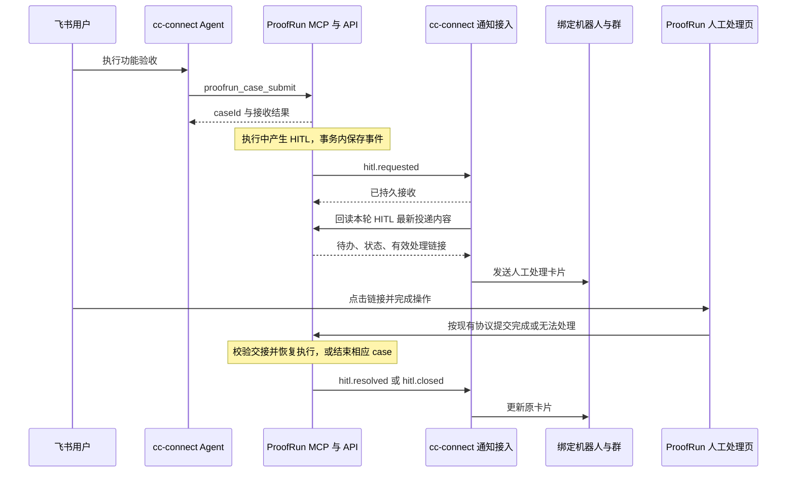

# ProofRun MCP 与 cc-connect HITL 通知接口设计

本文定义上层 Agent 通过 MCP 调用 ProofRun，并由 cc-connect 使用绑定的飞书机器人向指定群推送人工处理链接的接口与实施边界。ProofRun 侧已实现，cc-connect 侧待接；当前闭环使用模拟通知服务验证，尚未进行真实飞书投递。部署配置与实际接口见 [MCP 运行说明](../apps/api/src/modules/integrations/README.md)。首版以固定群绑定为主，复用现有 Case v2、人工处理页和 cc-connect 飞书消息发送能力。

## 1. 范围与职责

| 组件                  | 权威数据与职责                                                          |
| --------------------- | ----------------------------------------------------------------------- |
| Linear 与需求 Agent   | 需求及功能验收标准；需求修订与用例覆盖关系                              |
| ProofRun API          | case、执行组、报告、证据、HITL 状态及链接；通知事件的产生               |
| ProofRun MCP          | 有类型的调用入口；消费现有应用服务，不复制调度器或执行 Agent            |
| cc-connect 通知接入   | 机器人与群绑定、通知接收、飞书卡片发送与更新、投递回执                  |
| cc-connect 对话 Agent | 发起测试、查询和解释结果；复用既有用户交互与权限流程                    |
| LoopX                 | 保留现有研发任务、Turn 和验收机制；首版不修改 Issue Done 或 PR 合并条件 |

首版完成“飞书发起测试 → MCP 提交 → 需要人工 → 原机器人向配置群发卡片 → 人工在 ProofRun 页面处理 → 原测试继续”。通知不调用模型，也不依赖 MCP 连接、对话会话或 LoopX Worker 始终在线。



## 2. 现有实现与复用边界

- [Case API v2](public-api-v2.md)已有提交、查询、取消、重跑、逐组结果与证据入口；`CaseV2Service` 位于 `apps/api/src/modules/cases/v2.ts`。
- [HITL](hitl.md)已有 REQUESTED/HUMAN/AUTO 控制权交接、短期链接、条件确认、无法处理及原会话恢复。链接目前通过管理员或执行租约接口获取，公开 Case v2 不返回处理链接。
- `apps/api/src/modules/scheduling/control.ts` 在数据库事务中创建 `pr_interventions`。刷新过期链接会更换该表的 `id`，因此该字段不能直接作为长期通知聚合身份。
- dev-agent 的 `cc-connect/config/codex-config.toml` 已配置远程 MCP；`cc-connect/config/cc-connect.toml` 中现有 webhook/bridge 未开启。
- dev-agent 管理 cc-connect 的配置、Skills、版本与 Ansible 发布。核心二进制来自独立 `PPIO/cc-connect` 源码仓库；固定版本由 `cc-connect/config/versions.json` 指定。通知接入需要复用核心发送接口，不能假设在 dev-agent 加配置就能得到新 HTTP 路由。当前未取得该固定版本的核心源码，现有 bridge 能力须在实施前核验。
- 本地 Git 的 `origin/feat/acceptance-criteria` 在 `8ddafa4` 包含功能验收协议及结构校验器，当前检出的 dev-agent `main` 不包含这些文件。协议版本采用、合入和部署需要在实施时明确，不能把历史分支当成线上事实。

## 3. MCP 接口

### 3.1 传输与结果

在 ProofRun API 同源提供 `/mcp`，使用 Streamable HTTP；复用 API 生命周期和数据库连接，不启动第二套调度服务。当前使用锁定的官方 TypeScript SDK 1.32.1，cc-connect 实际客户端兼容性仍待联调，不依赖 MCP 长任务扩展，也不使用 MCP 会话身份作为业务身份。

工具声明 `inputSchema`、`outputSchema`，业务对象 Schema 复用 `contracts/schemas`。使用 `structuredContent` 返回机器结果，并提供兼容文本；截图用 MCP image 内容返回，普通结果不内嵌全部证据。参考 [MCP 工具规范](https://modelcontextprotocol.io/specification/2025-11-25/server/tools)和[传输规范](https://modelcontextprotocol.io/specification/2025-11-25/basic/transports)。这里引用的版本用于接口依据，不声称它是当前最新版本。

工具执行错误使用 `isError: true` 和结构化错误体；测试得出 FAILED 属于成功读取的业务结果，不是工具错误。错误体字段为 `code`、`message`、`retryable`、`effect`、可选 `caseId`；`effect` 为 `none / committed / unknown`。超时或断连不能推断未提交，恢复时查询原 caseId。

### 3.2 首版工具

| 工具                        | 输入                                 | 输出与约束                                                                                                             |
| --------------------------- | ------------------------------------ | ---------------------------------------------------------------------------------------------------------------------- |
| `proofrun_capabilities_get` | 空对象                               | 接口版本、Case Schema 版本、可用绑定别名、执行模式、限制、当前 readiness。就绪不证明模型或业务可用                     |
| `proofrun_case_validate`    | `{ case }`                           | 结构及可在接收前判断的配置错误、执行计划摘要、步骤分组、声明的证据能力。`executed: false`，不创建 case，不分配身份租约 |
| `proofrun_case_submit`      | `{ case, source?, notification? }`   | `{ accepted, deduplicated, caseId, definitionDigest, bindingRef, result }`；接收后立即返回，不等待测试完成             |
| `proofrun_case_get`         | `{ caseId }`                         | `{ result: CaseResultV2, interventions, notificationDeliveries }`；双跑完整保留 `comparison.arms`                      |
| `proofrun_case_cancel`      | `{ caseId }`                         | 同 v2 的整例取消语义；同时撤销本例各执行组的活动人工操作权                                                             |
| `proofrun_case_rerun`       | `{ caseId, newCaseId, budgetMode? }` | 沿用原业务定义、环境与通知绑定；新 case 身份，默认当前预算。相同重跑请求幂等                                           |
| `proofrun_evidence_read`    | `{ caseId, artifactId }`             | 校验归属后读取原字节、核对摘要；返回 MIME、SHA-256、大小和内容。超限明确拒绝，不伪装完整结果                           |

首版每次 submit 只接收一个 case，以便由调用者显式处理跨 case 顺序。现有 HTTP 批量 API 保留。MCP 不增加批量顺序调度或无人监管的后台 wait。Agent 完成本轮提交后可以结束会话，HITL 通知由服务继续发送。

`validate/get/capabilities/evidence_read` 标注只读；submit/rerun 可能引起真实业务操作，cancel 会终止执行。工具注解不授予权限，也不绕过 cc-connect 已有的执行授权。

### 3.3 提交示例

以下为结构示例，域名与身份不是可直接执行的测试配置：

```json
{
  "case": {
    "caseId": "issue-123-r1-attempt1-login",
    "platform": "测试平台",
    "entry": "https://app.example.test",
    "steps": [
      {
        "stepId": "prepare",
        "type": "setup",
        "url": "https://app.example.test/login",
        "exec_order": 1,
        "description": "使用配置的测试身份完成登录",
        "policy": ["仅使用指定测试账号"],
        "expected": []
      },
      {
        "stepId": "verify",
        "type": "verification",
        "url": "https://app.example.test/account",
        "exec_order": 2,
        "description": "检查当前账号信息",
        "policy": [],
        "expected": ["账号信息与指定测试身份一致"]
      }
    ],
    "cleanup": []
  },
  "source": {
    "kind": "linear",
    "reference": "issue-123",
    "revision": "source-revision-reference",
    "acceptanceRef": "case-1"
  },
  "notification": {
    "bindingRef": "triage-proofrun-qa",
    "events": ["hitl", "case.finished"]
  }
}
```

`case` 完全遵循 VerificationCaseV2；`source` 仅为可追溯的调用方声明，不构成经独立验证的需求身份、部署版本或授权。正式 LoopX 验收另行验证来源。

`notification` 省略时使用服务端为 MCP 客户端配置的默认绑定及事件集。首版接入配置要求存在默认绑定，HITL 通知固定启用；`case.finished` 可选。调用者不能填写任意 callback URL、机器人 appId、chatId 或关闭必需的 HITL 通知。

服务端为新提交补充缺省 stepId 后返回可追溯映射，但业务定义的幂等仍遵循现有 v2 原始定义口径。相同 caseId、原业务定义、source 及规范化后的通知绑定返回原结果；任一不同均返回 409，不更新已运行测试的收件人。显式和省略默认绑定在同一版本解析为相同快照时等价。

对已经属于当前客户端的 case，必须先读取原提交快照再处理缺省值：省略 notification，或显式传入原 bindingRef，都复用原冻结版本和事件集，不重新解析今天的默认配置。修改默认绑定、暂时禁用绑定或 cc-connect 离线，不影响原请求的幂等回读。显式改变绑定别名或事件集仍返回冲突；新默认配置只影响新 case。

网络重试复用原 caseId 和完整请求，不换 ID。更改验收或采用新的收件群必须使用新 case；已接收 case 不允许通过 MCP 临时改群。修复后重新执行使用新的 newCaseId，旧结果保留。

### 3.4 查询与证据

`proofrun_case_get` 在现有结果外增加 `interventions[]` 和 `notificationDeliveries[]`。每条人工请求包含 `hitlRequestId`、`executionId`、`arm`、`state`、`reasonCode`、`items`、`linkExpiresAt`、`waitDeadline`；通知状态包含 `eventId`、`accepted / delivered / retrying / unknown / failed / superseded`、可公开诊断。默认不向模型返回带 token 的处理 URL。

`linkExpiresAt` 与 `waitDeadline` 是不同期限，后者以当前控制面实际配置与状态为准。REQUESTED 表示正在交接，只有 HUMAN 才能实际人工操作。报告聚合继续采用现有 `reportStatus` 与 `criteriaCounts`；顶层结果只代表主组，不自行代表全部双跑结果。

MCP 客户端凭据只访问其已绑定的 case、各执行组及引用证据；拥有 case 访问权不代表可以浏览其他历史任务。初始服务限于受控内部部署，不新增用户系统或多租户承诺。

证据读取默认上限建议为 8 MiB，由单一配置管理。图片返回原图；结构化文本可返回完整有界内容，过大返回 `EVIDENCE_TOO_LARGE` 及元数据。普通 MCP 查询不返回管理员下载凭据，不让模型携带凭据请求任意 URL。

## 4. cc-connect 绑定

### 4.1 固定绑定

一个绑定表示一个确定的“ProofRun 集成来源 + cc-connect 项目 + 飞书平台实例 + 群”。同一机器人可以服务多个绑定；首版一个绑定只指向一个群。飞书 app secret 与发送 token 始终由 cc-connect 保管。

绑定的路由权威在 cc-connect，由部署配置管理，概念结构如下；不是当前已有的配置字段：

```json
{
  "bindingRef": "triage-proofrun-qa",
  "bindingVersion": 1,
  "integrationId": "proofrun-staging",
  "projectRef": "Triage",
  "platformRef": "feishu-primary",
  "destination": { "kind": "group", "chatId": "oc_configured_group" },
  "enabled": true
}
```

`platformRef` 必须稳定指向具体运行中机器人实例；若现有平台配置无稳定 ID，需要在 cc-connect 核心配置中补齐，不能依靠数组位置或显示名称选择机器人。绑定版本覆盖机器人、群和来源约束，改变这些内容必须产生新版本。

ProofRun 仅维护对应的集成连接配置：`integrationId`、固定 cc-connect HTTPS origin、双向服务凭据引用、允许的 `bindingRef + bindingVersion` 和默认绑定。不复制机器人密钥或 chatId；两侧的绑定版本通过部署时回读核对，ProofRun 存的是路由引用与冻结凭证。

在 cc-connect 侧增加服务身份读取接口：`GET /integrations/v1/proofrun/bindings/{bindingRef}?version=1`。返回来源允许范围、版本、启用状态、目标显示名称与机器人连接状态，不返回 app secret。ProofRun 在能力查询和每次新提交时核验，无法匹配则不准入新 MCP 提交；启动不依赖远端可用，以保留已有 case 的幂等查询；运行中关闭绑定会停止新投递并显式显示失败，不把已有 case 静默改发到新群。

更换群时新建绑定版本，旧版本保留到关联人工请求结束或被显式禁用。既有卡片只在原群更新，不能随默认配置变化迁移。

### 4.2 与测试原子关联

MCP 接收路径使用共享 CaseV2 应用服务，但增加私有集成提交封装 `POST /v1/integrations/cases`，请求体与 MCP submit 相同，供自动化和契约测试复用。凭据身份决定 clientId/integrationId，不能从请求正文自报。

case 定义、执行组、集成归属、source 与绑定快照必须在同一 PostgreSQL 事务内提交，然后才允许调度器领取。必须重构 submitCaseBatch 的事务边界以接受集成元数据，不能先调用公开 `/v2/cases` 再补绑群。外部绑定检查在事务前进行，不在事务中调用 cc-connect；远端可用性在投递时再核验。

历史 HTTP case 不会因默认绑定新增而自动向飞书发送；集成提交遇到已存在但无同一归属的 caseId 返回冲突，不能借幂等请求认领其他任务。重跑路径同样原子复制归属与绑定快照。

### 4.3 原话题与其他入口

首版固定群模式不要求原飞书消息仍存在，也不要求当前 Agent 会话存活。群卡片及其飞书 messageId 保存在投递回执中，后续事件更新同一张卡片。

后续需要回复原话题时，增加由 cc-connect 根据可信消息事件生成的 `deliveryContextRef`。它绑定项目、机器人、群、原消息、来源及有效期，ProofRun 只保存不透明引用。不得让模型填写任意 threadId/chatId 充当来源证明。该扩展不列入首版。

LoopX 以后调用同一 MCP 时可使用预配置固定绑定，不需要伪造飞书用户上下文；其调用身份和 case 所有权需另行配置。当前阶段不接入 LoopX 自动结算。

## 5. HITL 事件与投递接口

### 5.1 稳定身份与事件种类

新增 `hitlRequestId`，在请求人工的事务中生成，链接刷新时保持不变。现有 intervention `id` 继续作为链接授权身份，轮换不会改变逻辑人工请求。下一轮人工交接使用新的 hitlRequestId。

每个 hitlRequestId 有单调递增 `sequence`。每个事件有永久不变的 `eventId`，重投保留 ID、序号与正文；同 ID 不同正文为冲突。`arm` 区分 llm/jev，两组人工请求分别关联，不把一组处理完成认定为另一组完成。

| 事件             | 触发与界面语义                                                     |
| ---------------- | ------------------------------------------------------------------ |
| `hitl.requested` | 人工请求已保存；卡片显示待办，若尚在 REQUESTED 则说明正在交接      |
| `hitl.updated`   | 进入 HUMAN、链接轮换或其他影响展示的实际变化；更新原卡片           |
| `hitl.resolved`  | 交接已由 ProofRun 接受并恢复 AUTO；显示已交还执行，不表示业务通过  |
| `hitl.closed`    | 无法处理、等待超时、任务取消、租约失效或其他终止；原因取自权威状态 |
| `case.finished`  | 可选；所有执行组均终态后发一次结果摘要，各组业务与清理结论分开展示 |

`case.finished` 用独立 case 聚合身份与序号，重复终态回读不重复造事件。事件不是 MCP notification，也不是必须交给模型的新用户消息。

事件 Schema 按 type 区分：四种 HITL 事件要求 executionId、taskId、arm 和 hitl 聚合；case.finished 使用 `{ kind: "case", id: caseId, sequence }`，不要求执行身份，view 返回各组终态与业务／清理摘要。数据历史清理的保留期必须覆盖事件派发和回执重试窗口；绑定尚有活动请求时不能删除对应聚合或去重记录。

### 5.2 事件接收

cc-connect 新增 `POST /integrations/v1/proofrun/events`。以下字段均为建议契约：

```json
{
  "schemaVersion": "proofrun.notification.v1",
  "eventId": "evt-example-001",
  "type": "hitl.requested",
  "occurredAt": "2026-10-15T08:00:00Z",
  "integrationId": "proofrun-staging",
  "bindingRef": "triage-proofrun-qa",
  "bindingVersion": 1,
  "caseId": "issue-123-r1-attempt1-login",
  "taskId": "case-v2-issue-123-r1-attempt1-login",
  "executionId": "execution-example",
  "arm": "llm",
  "aggregate": {
    "kind": "hitl",
    "id": "hitl-request-example",
    "sequence": 1
  }
}
```

请求不携带处理 token、任意 URL、飞书收件人或卡片 JSON。cc-connect 按自己的 binding 路由，并从已配置 ProofRun origin 回读内容，避免消息来源决定任意发送内容或目标。

通过专用 Bearer 服务身份验证来源，并检查 integrationId 与 bindingVersion；HTTPS 保护传输。该凭据只允许本集成的绑定回读、事件写入及回执读取，不能调用 cc-connect 对话管理或任意消息发送。固定受管 origin，禁止跟随重定向携带凭据。

首次持久接收返回 202：

```json
{
  "eventId": "evt-example-001",
  "receiptId": "receipt-example-001",
  "status": "accepted"
}
```

同 eventId 同正文返回 200 和原 receipt；不同正文返回 409。400 表示契约错误，401/403 表示凭据或绑定不匹配，429/5xx 为可退避重试。202 只证明 cc-connect 已持久接收，不表示飞书投递成功。

### 5.3 内容回读与回执查询

ProofRun 新增 `GET /v1/integrations/notifications/{eventId}/view`，只允许 cc-connect 专用回读身份访问本集成、绑定下的事件。该接口无写副作用，读取对应聚合的最新状态而非重放旧正文。

返回 `eventId`、`aggregateId`、`currentSequence`、case/执行组标识、标题、状态、待办、原因、`action` 和是否 superseded。活动请求的 action 为 `{ type: "open_url", url, expiresAt }`；任务已经结束则 action 为 null，附结束原因。URL 仍采用既有 `/#/hitl/<id>/<token>`，只在发送进程内存中组装卡片，不保存到事件、普通日志或模型上下文。

链接到期时本 GET 不自动轮换：返回 `linkState: "expired"` 与无 action。ProofRun 维护循环仅为仍有有效等待权的请求调用受控的现有轮换逻辑，发布 hitl.updated；并发轮换按 hitlRequestId 加锁，终态不刷新。链接刷新不延长任务等待期限。卡片更新失败仍由投递状态体现。

cc-connect 提供 `GET /integrations/v1/proofrun/deliveries/{eventId}`，返回 `accepted / retrying / delivered / unknown / failed / superseded`、attempts、nextAttemptAt、lastErrorCode 及允许回传的 messageRef。ProofRun 维护循环有界回读直到终态，缓存为投递观察；cc-connect 的回执才是投递事实来源，不影响测试或 HITL 的权威状态。

已存在的失败事件通过管理端重投原事件处理，不新增人工请求、不换 caseId。若绑定或凭据修复，保留原事件和回执关联。

## 6. 可靠性与人工权限

### 6.1 两段持久投递

ProofRun 在 HITL 变更事务中写 outbox；事务回滚则不产生通知。取消、超时、租约失效、整例无法处理等终止路径必须同步结束对应人工通知聚合。维护循环扫描仍活动的通知聚合与权威执行状态，修复漏投影；依靠唯一约束避免重复事件。

API 当前持锁主实例负责 outbox 派发，丢失数据库所有权时停止派发；发送在事务外进行。cc-connect 先持久保存 inbox 和去重键，再 ACK，再异步回读及发送。服务重启后继续未结束的投递。

这是一条至少一次事件投递链路。建议初始配置为单次请求 10 秒，指数退避 2 秒至 60 秒并加抖动，尊重 Retry-After；鉴权／配置错误不紧密重试。重试预算、过期与维护扫描间隔各自只有一个配置来源。默认 24 小时未恢复则记为 failed，保留诊断供原事件重投，不能无限占用热队列。

### 6.2 顺序与重复卡片

cc-connect 对 `(integrationId, aggregateId)` 串行处理，记录已应用 sequence 和 messageId。新事件每次先回读当前状态；旧事件不覆盖新卡片。终态先到时，后到的 requested 只被标记 superseded，不创建新的可操作卡片。

飞书首次发送后、回执落盘前崩溃是外部效果未知窗口：优先使用现有发送层经验证的供应方幂等身份或查询回执。必须确认固定版本支持范围及去重有效期；没有可验证通路时标记 unknown，禁止盲目重发，也不宣称 exactly-once。重试和重启验收必须覆盖这个窗口。

状态回读与飞书发送之间仍可能发生完成／取消。后续终态事件负责收敛卡片；即使短暂显示旧链接，ProofRun 在实际访问和每条人工操作时继续验证控制权、期限及租约，不会因卡片旧而恢复操作权。

### 6.3 人工完成与消息权限

卡片仅提供“打开处理页面”的 URL 操作。群里回复“好了”、点击通知确认或投递成功，都不能调用管理员 resume，也不能替代条件确认或产生 PASSED。完成与无法处理继续走现有 ProofRun 页面及 API。

处理链接是短期持有者凭据；固定群的成员及获得转发链接者可能使用它，绑定群不是个人身份认证。首版保持现有 HITL 权限模型；有指定个人访问要求时再设计身份认证。链接进入飞书消息属预期交付，禁止进入常规日志、遥测及模型提示词。

相同机器人身份由 cc-connect 已注册平台实例提供，通知不创建新机器人，也不把飞书凭据交给 ProofRun。通知发送不作为新的群消息输入再次唤醒对话 Agent，避免自触发循环；用户后续主动提问仍沿用原会话规则。

### 6.4 三类凭据

| 凭据             | 接收方与范围                                                        |
| ---------------- | ------------------------------------------------------------------- |
| MCP 服务凭据     | ProofRun；限定 clientId、允许绑定与其 case 的提交／读取／取消／重跑 |
| 通知投递凭据     | cc-connect；限定 integrationId 的事件接收、绑定及回执读取           |
| 通知内容回读凭据 | ProofRun；仅回读同集成通知内容，无任务变更和管理员恢复能力          |

三者独立轮换，按现有 Vault／私密部署配置注入，不复用 PROOFRUN_ADMIN_TOKEN。首版远程 MCP 为受控内部服务账号接入；若要支持通用第三方客户端自动授权，需另行实现并验证 MCP 授权发现及 OAuth 流程，不将静态凭据宣称为完整的通用授权实现。

## 7. 功能验收协议适配

沿用 requirements-clarity 的需求生成职责，ProofRun 不生成或扩写验收标准。新增执行 Skill 负责从 Linear 提取选定协议、保存来源与摘要、准备 v2 输入并调用 MCP。

| 差异                                               | 首版处理                                                                                                                     |
| -------------------------------------------------- | ---------------------------------------------------------------------------------------------------------------------------- |
| 旧协议缺 caseId/stepId                             | 调用方在提交前确定并保存 caseId，按原位置生成稳定 stepId，保留源 case/步骤映射；网络重试复用                                 |
| 旧 setup 不允许 expected                           | 转换时补 `expected: []`，不增加验收项                                                                                        |
| 原协议 case 数组默认顺序执行                       | 一次提交一个 case，后续需读取前例终态与清理结果；跨会话自动顺序续跑不属于首版                                                |
| 原协议递增 exec_order 表示依赖，同序号可能允许并发 | ProofRun 按 setup 分组，同序号不保证并发；执行 Skill 必须核对分组。依赖跨组时返回 `ORDERING_NOT_REPRESENTABLE`，不能静默投递 |
| 自然语言等待与显式 wait 不同                       | 仅将有明确依据的时长转成 wait.durationMs；不能猜测数字                                                                       |
| 原协议期望必要清理                                 | 展示 ProofRun 实际清理前提与结果，不承诺取消／失联后自动补偿                                                                 |

结构校验无法证明自然语言中的依赖、身份或恢复值。需要重组 setup 时保留原标准并明确差异，不能用适配层自行改业务含义。若无法在现有分组语义下表达依赖，另行扩展 ProofRun 的显式执行契约；本次通知接入不顺带改调度语义。

## 8. 两个项目的改动位置

### 8.1 ProofRun

| 路径或模块                                                      | 改动                                                                                                           |
| --------------------------------------------------------------- | -------------------------------------------------------------------------------------------------------------- |
| `contracts/schemas/` 与生成入口                                 | 新增 MCP envelope、提交上下文、绑定引用、通知事件、view 与回执观察 Schema；复用 Case/结果类型并生成 TS/OpenAPI |
| `apps/api/src/modules/mcp/`（新增）                             | 工具注册、输入输出校验、受限调用身份、结果映射和证据媒介输出                                                   |
| `apps/api/src/modules/integrations/`（新增）                    | 集成身份、绑定快照、提交归属、通知 view，集中做 case／事件归属校验                                             |
| `apps/api/src/modules/notifications/`（新增）                   | outbox、派发、回执查询、退避与状态投影；只负责通知，不执行业务恢复                                             |
| `apps/api/src/modules/cases/v2.ts`、`scheduling/coordinator.ts` | 支持集成上下文与任务原子接收、幂等冲突及重跑复制；保持原公开 v2 兼容                                           |
| `scheduling/control.ts`、`hitl/service.ts`、任务终止路径        | 稳定 hitlRequestId、事务内事件、终态关闭、链接轮换事件；复用人工权限校验                                       |
| `apps/api/migrations/`、`db.ts`                                 | 增加 case 集成归属、通知聚合与 outbox；在 interventions 保存稳定请求身份，历史记录按需关联，不给旧任务追发     |
| `config.ts`、`app.ts`、服务生命周期与部署模板                   | 注册 MCP／集成路由，加载凭据与固定 origin，主实例运行派发器                                                    |
| Console 任务详情与测试                                          | 展示通知目标名称和投递失败／未知状态；无需重新实现人工处理页                                                   |

建议新增表为 `pr_case_integrations`、`pr_notification_aggregates`、`pr_notification_outbox`；投递观察可附在 outbox 上。绑定静态配置仍只有一份权威，case 表保存版本快照。不要把飞书消息状态存为新的任务状态机。

无需改 Browser Node 协议、执行 Agent 提示词或浏览器操作工具；事件从现有控制面状态产生。只有协议适配要求的新执行语义才另立范围。

### 8.2 dev-agent 与 cc-connect

| 路径或模块                                                    | 改动                                                                                                             |
| ------------------------------------------------------------- | ---------------------------------------------------------------------------------------------------------------- |
| cc-connect 核心（独立 `PPIO/cc-connect` 仓库）                | 增加受鉴权的通知接入、绑定回读与投递回执路由；复用已注册飞书平台的发送／更新接口；持久 inbox、聚合消息关联与恢复 |
| `cc-connect/config/cc-connect.toml` 及受管配置                | 通知监听配置、固定绑定、稳定平台实例 ID；限制调用范围，不直接开放整个管理接口                                    |
| `cc-connect/config/codex-config.toml`                         | 注册 ProofRun MCP endpoint、凭据环境变量及七个工具；沿用现有工具授权流程                                         |
| `cc-connect/config/agent-vault-services.json`、运行包装器     | MCP 与双向通知凭据注入、固定地址配置、脱敏                                                                       |
| `cc-connect/skills/requirements-clarity/`                     | 明确采用的功能验收协议版本，保留标准生成与发布职责；不把执行写进需求结构校验器                                   |
| `cc-connect/skills/proofrun-execution/`（新增）               | 提取协议、准备 v2、检查分组依赖、提交／查询／取消／复测及解读结果；提示词独立成文件                              |
| `cc-connect/config/skills.json`、`managed-files.json`         | 纳入新增 Skill 和非密配置，更新受管摘要                                                                          |
| `cc-connect/config/mcp-checks.json`、`scripts/mcp-runtime.py` | 增加只读 capabilities 探针与契约验证；发布检查不得提交真实测试                                                   |
| `cc-connect/config/versions.json`、`deploy/`                  | 核心改动的新二进制 pin、迁移、通知持久目录、端口／网络、Ansible 部署与读回                                       |
| `tests/` 与核心测试                                           | 合成 ProofRun／飞书供应方验证路由、投递、恢复与卡片内容                                                          |

核心持久层的具体文件位置需取得固定版本源码后确定。优先复用现有可靠发送与存储抽象；缺少持久 inbox 时新增小型投递表，不使用内存 Map 承诺重启恢复。这里不新增独立模型调度服务，也不让通知由临时聊天回合转发。

因此从产品范围看是两个项目协同，从代码交付看可能包含第三个仓库 `PPIO/cc-connect` 的核心补丁。若现有 bridge 已具备所需鉴权、持久接收、平台路由、消息更新和回执，可以只补缺失部分；仅有同步 send 接口不足以替代整条通知契约。

`loopx/src/validator-cli.ts`、Goal 完成规则、原生 CLI、PR 状态投影不属于首版修改范围。后续研发自动验收再接入 ProofRun 的独立结果验证。

## 9. 实施顺序与验收

1. 固定契约：确认 cc-connect 核心扩展点与机器人实例身份；采用功能验收协议版本；把本文新增结构落到 contracts，先建立合成供应方测试。
2. MCP：接通七个工具、受限服务身份、原子 case 绑定及结果回读。验证 MCP 连接断开不取消已接收任务。
3. HITL 通知：落地稳定请求身份、outbox/inbox、卡片发送与更新、回执查询和服务重启恢复。
4. 真实联调：配置一个机器人和专用群，使用隔离测试账号完成请求人工、操作处理页、原任务继续及通知收尾。

| 场景                 | 必须观察的结果                                                                   | 覆盖边界                                         |
| -------------------- | -------------------------------------------------------------------------------- | ------------------------------------------------ |
| Schema 与工具发现    | 工具参数、输出、错误与文档一致；FAILED 报告不是工具故障                          | 不证明真实浏览器与模型质量                       |
| 提交丢 ACK 与重试    | 同 caseId 不重复执行；绑定与定义变化被拒绝；提交后立即触发 HITL 仍有正确收件绑定 | HTTP／数据库夹具验证，不代表飞书送达             |
| 无权限或错误绑定     | 无法查询别的客户端 case，不能自报群或 callback URL；新版本不迁移旧消息           | 不替代飞书群成员权限测试                         |
| 事件重复／乱序／重启 | 202 之后重启不丢事件；旧 requested 不覆盖已完成；发送未知不盲目重发              | 合成供应方不能证明真实飞书幂等能力               |
| 链接刷新／取消       | 稳定 hitlRequestId 不变；原卡片更新；取消／终态禁止操作；GET view 无写副作用     | 需真实处理页复核链接 fragment 在客户端中完整保留 |
| 双跑与多轮人工       | 两组与各轮身份分开；一组完成不清除另一组待办                                     | 不保证共用账号业务数据隔离                       |
| 人工完成／无法处理   | 页面确认才恢复或结束；群回复不恢复；恢复后重新观察；失败原因保留                 | 脚本模型只证明交接机制                           |
| 真实飞书闭环         | 绑定机器人在正确群发送可打开卡片，完成后更新；机器人重启后仍可收尾               | 需真实机器人权限、可达 HTTPS/WSS 和独立测试环境  |

首版验收以明确记录的隔离场景为准。消息成功投递、HITL 完成和业务验收通过是三个不同事实。实际部署、群消息联调和代码实施不由本文自动执行。
