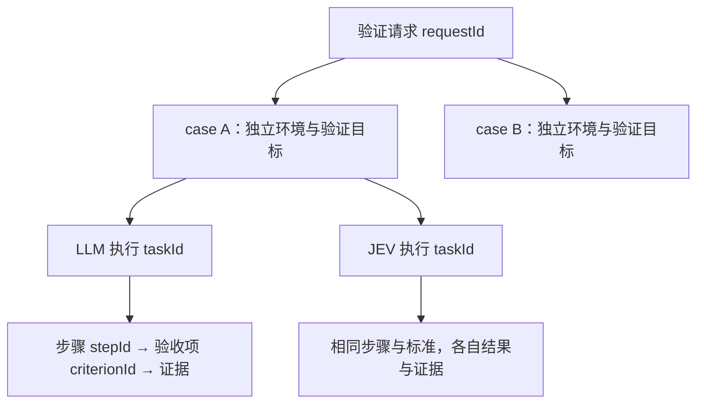

# v2 请求归属与验证报告汇总设计

本文记录已实现的请求归属、任务展示、报告汇总和整请求重跑设计；公开接入方式见 [Case API v2](public-api-v2.md)。

## 1. 设计结论与现状

请求维度已确认为：一次提交的多个 case 属于同一个验证请求。增加稳定的 `requestId`，将任务和报告的默认阅读单位提升到请求；case 保留独立环境、执行和重跑身份，LLM/JEV 保留各自的结果与证据。

实施前的主要约束：

- `CaseV2Service.submit` 接收数组、按 caseId 幂等；`Coordinator.submitCaseBatch` 原子创建执行任务，但没有保存批次归属。
- 不同请求允许重叠 caseId；相同定义复用已有执行，不代表重新验证。
- 一个 case 默认展开为 LLM、JEV 两个任务；现有 `CaseResultV2` 顶层只是 LLM 主组投影。
- Console 的任务和报告列表都查询 `/v1/tasks`，按 taskId 分页；报告列表仅查询已有报告的任务，无法显示同请求尚无报告的其他成员。
- `summarizeReport` 已统一单组业务结论，排除 cleanup；setup 中显式声明的 expected 仍属于业务验收范围。

因此不能只在前端给当前页任务分组，也不能把两组的 criteriaCounts 直接相加作为请求验收数量。

## 2. 身份与归属



| 身份                   | 职责                                | 约束                                                          |
| ---------------------- | ----------------------------------- | ------------------------------------------------------------- |
| requestId              | 一次逻辑提交的稳定身份与汇总入口    | HTTP 重试沿用；重新验证使用新身份                             |
| caseId                 | 独立 profile 的验证目标集合         | 保持现有全局幂等规则，不改为请求内局部身份                    |
| taskId / executionMode | case 的一次具体执行组               | 由冻结定义确定，不因当前平台配置变化而增减                    |
| stepId                 | setup、verification 或 cleanup 步骤 | 现有排序、分组与执行语义不变                                  |
| criterionId            | 一条 expected 的身份                | 跨 case 关联使用 `(caseId, criterionId)`；证据还须定位 taskId |

请求与 case 使用关联表，允许多对多。通常一个 case 只出现在一个请求；显式提交新的 requestId 并复用旧 caseId 时，新请求引用旧执行，显示“复用已有执行”和原执行时间。不得把它显示为本次重新验证。

请求归属不写入 case 原始定义或任务定义哈希，否则加入另一个请求会破坏现有 case 幂等语义。请求不是调度单位，不共享浏览器、账号、预算或取消信号，也不添加 case 间执行依赖。

## 3. 提交与查询协议

### 3.1 在现有入口增加请求封装

`POST /v2/cases` 增加对象格式，保留原数组格式。对象中的每个 case 完整复用现有 `VerificationCaseV2` Schema。

以下为结构示意，`cases` 处省略完整定义，不能直接作为合法请求发送：

```text
{
  "requestId": "release-20261019-invite-01",
  "title": "邀请活动回归",
  "cases": [完整的 case A, 完整的 case B, 完整的 case C]
}
```

- requestId 必填，沿用 caseId 的 1–80 位安全字符规则，但使用独立命名空间。
- title 可选，提供时为 1–200 字符非空白文本；默认显示 requestId。它仅用于展示，不生成验证目标或验收标准。
- cases 为 1–32 项，仍受整请求 2 MiB 限制；拒绝重复 caseId 和未知顶层字段。
- 对象格式返回 `202 RequestResultV2`；原数组格式仍返回 `202 CaseResultV2[]`，不改变老调用方响应形状。
- 原数组不携带稳定请求身份，继续作为兼容入口，不自动制造推测性归属。需要请求展示和汇总的上游切换到对象格式；Console 的 v2 提交也使用对象格式。
- 旧数据及继续使用数组入口的数据在 Console 的“未归组任务”视图保留。不能把上线后所有旧格式调用宣称为已支持请求归属。

### 3.2 幂等与事务

首次接收冻结请求标题、case 顺序、原始定义摘要、成员关系以及实际执行组引用。

同 requestId、同定义重提返回现有请求的最新状态；改变标题、成员或任一 case 定义返回 `409 REQUEST_CONFLICT`。仅调整 cases 数组顺序不产生新身份，响应仍使用首次接收顺序；case 内 steps、policy、expected 等数组保持现有顺序敏感规则。

不同 requestId 可引用相同 caseId，但定义不一致仍返回 `409 CASE_CONFLICT`。相同定义复用首次冻结的环境和执行组，在成员项中标识 `executionOrigin: "reused"`；首次创建标识 `"created"`，此标记不因重提而改变。

请求行、成员关系、新 case 的所有执行组必须在同一数据库事务提交。不能先调用现有 submit 完成入队，再另一个事务写请求归属。请求冲突、case 冲突、编译失败或数据库失败均不留下部分新增记录，也不影响已存在的 case。

沿用确定性加锁：先锁请求身份，再按排序后的 case 身份加锁；所有入口使用同一 case 锁规则。事务内复核 case 定义与实际执行组，避免并发编译使用了不同平台配置而记录错误成员。

### 3.3 查询接口

| 接口                                  | 返回内容                                                               |
| ------------------------------------- | ---------------------------------------------------------------------- |
| `GET /v2/requests`                    | 请求摘要列表，支持 q、executionStatus、reportStatus、limit、cursor     |
| `GET /v2/requests/{requestId}`        | 请求元数据、全量成员及各执行组进度、汇总摘要                           |
| `GET /v2/requests/{requestId}/report` | 请求汇总报告、case 结论矩阵、两组差异、缺失范围及原报告入口            |
| `GET /v2/cases/{caseId}`              | 保持既有结果；请求查询提供关联导航，不能使用原顶层主组结果代替双组汇总 |

请求详情最多 32 个 case、64 个执行组，首版无需成员分页。请求列表按请求分页，游标使用数据库微秒创建时间与 requestId，绑定全部筛选条件。搜索命中某个 case 时仍返回完整请求统计，不只汇总命中的成员。

所有新接口沿用管理员认证。证据继续使用现有 case/task 证据入口并校验归属；汇总 API 不提供绕过认证的证据地址。

## 4. 汇总模型与判定

### 4.1 三种数量分开展示

| 维度             | 例子      | 用途                                               |
| ---------------- | --------- | -------------------------------------------------- |
| case 数          | 3 个 case | 请求包含多少组验证目标                             |
| 执行组数         | 6 次执行  | 调度进度、LLM/JEV 各自状态                         |
| 唯一业务验收项数 | 8 项      | 由各 case 的 expected 定义去重，不因双跑变成 16 项 |

verification 步骤数量可作为详情辅助信息；不能用步骤数替代验收项数。setup 的 expected 保持现有统计口径，policy 不计为验收项，cleanup 的 expected 不计入业务汇总。

### 4.2 执行进度与报告完整性

请求增加独立字段，不借用任务原有 status 表达业务结果：

| 字段                             | 规则                                                                                   |
| -------------------------------- | -------------------------------------------------------------------------------------- |
| executionStatus                  | 所有组均排队为 QUEUED；所有组进入终态为 FINISHED；其余为 IN_PROGRESS                   |
| executionCounts                  | total、queued、running、completed、cancelled、timedOut、error；互斥分类之和等于 total  |
| reportPhase                      | 无已交付报告且未全部终止为 PENDING；部分报告且未全部终止为 PARTIAL；所有组终止为 FINAL |
| reportCoverage                   | expected、available、missing；available + missing = expected，终态缺报告仍显示 missing |
| reportStatus                     | 请求最终结论；非 FINAL 时为 null，界面显示“尚未汇总完成”                               |
| observedFailureCount             | 已交付报告中确认失败的唯一验收项数；执行期间也显示“已发现失败”，不冒充最终结论         |
| generatedAt / aggregationVersion | 本次读取快照时间与汇总算法版本，导出携带相同值                                         |

FINISHED 只说明执行结束，FINAL 只说明可以形成最终汇总；都不代表通过或子报告齐全。全部取消、全部超时或者执行终态缺报告仍可形成明确列出缺失范围的请求汇总，不能伪造子报告。

### 4.3 从单组到 case，再到请求

单组结论继续调用现有 `summarizeReport`，不重新实现另一套清理、阻塞或缺失结果口径。

case 的要求范围取首次冻结的执行组：单组只要求自身，双跑要求 LLM 与 JEV。只有 case 的全部执行组终止后才形成最终 case 汇总结论：

1. 任一要求组的 reportStatus 为 FAILED → case 为 FAILED。
2. 全部要求组都有报告且均为 PASSED → case 为 PASSED。
3. 其余情况，包括终态缺报告 → case 为 INCONCLUSIVE。

请求 FINAL 时按相同顺序汇总 case：任一 FAILED 则 FAILED；全部 PASSED 才 PASSED；否则 INCONCLUSIVE。清理异常独立展示，不改变已有业务通过结论；环境故障、人工无法执行、排队超时或取消不能直接算产品失败。

这里 FAILED 表示“本请求要求的执行结果中存在已报告的验收失败”。两组出现冲突时必须同时标明“组间结论不同”，供沿证据复核；不能将汇总摘要扩写成已确认的产品根因。

### 4.4 唯一验收项统计

新增 `uniqueCriteriaCounts`，不覆盖原单组 criteriaCounts。按 `(caseId, criterionId)` 合并要求组的结论，依次应用：

1. 任一组已有最终报告确认该项 FAILED → failed。
2. 否则任一要求组未进入终态 → pending。
3. 否则所有要求组该项均 PASSED → passed。
4. 否则所有要求组该项均缺失或 SKIPPED → skipped。
5. 其余，包括通过与缺失并存、明确 INCONCLUSIVE → inconclusive。

`total = passed + failed + inconclusive + skipped + pending`。缺报告按该组该项缺失处理，原单组 reportStatus 与 criteriaCounts 仍为 null。实时步骤结果可在执行详情展示，不充当已交付报告的最终判断。

验收项全部通过但前置业务步骤未完成时，case 仍可能 INCONCLUSIVE。因此请求结论必须从完整单组 reportStatus 聚合，不能只看 uniqueCriteriaCounts。

另外提供 `byExecutionMode`，分别展示 LLM/JEV 的 case 覆盖数、原单组验收统计和缺报告数。未配置某个模式的 case 标记“不适用”，不计为该模式缺失。

### 4.5 组间差异

对同一 `(caseId, criterionId)` 对齐两组结果，显示双方状态和证据入口。两组均有明确 PASSED/FAILED 且相反才计入 `confirmedDisagreementCount`；无法判定、未执行、缺报告单独列为覆盖差异，不伪装成明确判断冲突。单组 case 不参与比较。

## 5. Console 展示

保留“验证任务”“验证报告”两个主导航；默认使用请求视图，并提供“未归组任务”和“执行明细”入口。原 taskId 深链接继续有效。

### 5.1 验证任务

每个请求一条主记录，可展开 case，执行组作为 case 下的并排状态，不再把双跑显示成两个无关目标。

```text
邀请活动回归                         执行中        查看请求
release-20261019-invite-01
3 个 case · 6 次执行 · 已结束 4/6 · 已发现失败 1 项

  case A  访客入口展示       LLM 已结束/通过    JEV 已结束/通过
  case B  已登录用户领取     LLM 已结束/未通过  JEV 已结束/通过  组间不同
  case C  再次领取限制       LLM 执行中         JEV 排队中
```

请求详情提供“总览与验证目标 / 汇总报告”页签。总览展示请求标题、ID、创建时间、进度与问题；验证目标展开 verification 步骤与 expected。setup、清理保持各自分区。

case/执行详情增加来源导航；同 case 出现在多个请求时显示“关联 N 个请求”，不能任选一个显示成唯一归属。从请求进入执行详情时保留来源请求上下文，允许直接返回。

### 5.2 验证报告

报告列表每个请求一行，自请求创建起即可显示“等待结果”“部分结果”“最终汇总”，不能沿用 reportOnly 过滤掉无报告的成员。

请求报告按以下顺序阅读：

1. 请求标题、最终/部分标记、请求结论、case 完成数、唯一验收项统计和报告齐全程度。
2. 失败项、未覆盖范围、缺报告、组间不同；环境阻塞与业务失败分别注明。
3. case 矩阵：case、综合结论、LLM、JEV、验收项覆盖、清理状态、详情入口。
4. 展开的 case 内按步骤列出 expected，每行并排展示两组结论和各自证据。
5. 原始报告、请求成员、复用来源、生成时间及汇总算法版本。

未通过和未覆盖的 case 默认展开，通过的 case 默认折叠。窄屏下 LLM/JEV 上下排列，始终保留模式名称；颜色只辅助判断，状态必须有文字。沿用现有 Console 样式变量与证据预览。

### 5.3 报告导出

导出与页面使用同一服务端快照，JSON 包含 requestId、标题、冻结成员、generatedAt、aggregationVersion、报告阶段、聚合结论、唯一项统计、两组统计、差异和成员报告事实/引用。不得把不同时间读取的列表数字与详情拼成一份报告。

执行中可导出，但文件与内容明确标为部分报告。最终报告保留缺失项；证据被清理时显示不可用，已有结论不变。摘要先使用确定性模板，不新增 LLM 总结调用，也不让模型裁决两组冲突。

## 6. 重跑和操作边界

请求成员接收后固定，不追加或替换 case，不把先后两次执行揉成同一份最终报告。

- case 的取消、HITL 和重跑继续使用原有能力。复用 case 的页面在操作处提示关联请求数，取消会影响所有引用同一执行的请求。
- 首版不增加一键取消整个请求，避免把聚合读取能力隐式扩展成共享执行的级联取消。
- “重跑整个请求”创建新的 requestId、全部新的 caseId，保存 sourceRequestId 和逐个 sourceCaseId；沿用各 case 冻结的环境与模式，预算策略复用现有重跑规则。
- 请求重跑应由 `POST /v2/requests/{requestId}/rerun` 接收目标 requestId、完整旧新 caseId 映射及可选 budgetMode/timeBudget。必须一次事务创建全部目标，不能由前端循环调用单 case 重跑后拼接。映射必须覆盖全部成员且新身份互不重复、不同于旧身份；缺省 budgetMode 为 current。
- 请求重跑幂等摘要包含来源、映射与重跑参数；同目标 requestId 重试返回首次结果，参数变化返回 REQUEST_CONFLICT。所有重跑目标 caseId 必须为本次新建，或属于这个目标请求的同一次幂等重试，避免意外复用无关旧执行。
- 只重跑一个 case 时保持现有接口，新执行不自动加入原请求，也不替换原请求成员。若需一份“部分重跑报告”，使用新请求明确列出实际重跑范围，不宣称整请求重新通过。

请求详情优先暴露已有 case 操作；整请求重跑只有上述原子服务完成后才提供按钮。

## 7. 持久化与模块职责

### 7.1 数据结构

| 表/字段                       | 保存内容                                                                                             |
| ----------------------------- | ---------------------------------------------------------------------------------------------------- |
| pr_verification_requests      | request_id 主键、title、definition_hash、created_at、可选 source_request_id、可选重跑参数快照        |
| pr_verification_request_cases | request_id、case_id、主 task_id、position、原始 case 定义摘要、execution_origin、可选 source_case_id |
| pr_verification_request_arms  | request_id、case_id、execution_mode、task_id；按实际冻结组保存                                       |

成员表主键为 `(request_id, case_id)`，`(request_id, position)` 唯一；执行组表主键为 `(request_id, case_id, execution_mode)`，task_id 外键指向 pr_tasks。case_id、task_id 建反向索引，用于来源导航和影响范围查询。请求不可变字段无需写入可变汇总状态。

首版按读时聚合，不增加存储一份汇总正文的独立报告任务。列表只批量读取必要状态、报告事实和定义范围，不读取截图或完整报告正文；不能按每个请求、每个 case 逐项调用现有 get 形成 N+1 查询。

详情与导出在同一一致性数据库快照中读取成员、定义、任务和报告，避免已结束计数与缺报告统计相互矛盾。聚合算法输出携带版本；将来改变算法不能静默重标旧导出的版本。

### 7.2 模块分工

- contracts：增加请求提交、摘要、详情、汇总报告和重跑 Schema；生成类型；新增纯函数汇总模块并复用 report-status.ts。
- API cases：提取可复用的校验、冻结编译与事务入队能力，保持旧数组入口行为。
- API requests：独立 service、reader、report 模块，负责请求身份、关联、查询快照与导出投影。
- Console：拆分请求列表、请求详情、请求报告、case 矩阵组件；复用现有单组报告和证据组件。
- Agent / Browser Node：无需感知请求归属，不改执行协议或调度资源模型。

## 8. 实现顺序与验收边界

实现包含 Schema、迁移、请求幂等事务、统一汇总、请求查询、任务与报告视图、JSON 导出，以及整请求原子重跑。历史未归组入口保留。

需要覆盖的验收场景：

| 场景                                 | 预期                                              |
| ------------------------------------ | ------------------------------------------------- |
| 一次提交三个双跑 case                | 一条请求、三个 case、六个执行组，验收项不翻倍     |
| 相同 requestId 重提，包括 cases 重排 | 只有一个请求，首次顺序稳定，无重复执行            |
| 请求或 case 定义冲突、并发交叉批次   | 整批回滚，无孤立任务/归属，无顺序死锁             |
| 新请求引用已有相同 case              | 明确标记复用，显示原执行时间，不篡改旧请求        |
| LLM 完成、JEV 仍排队                 | 部分报告，请求最终结论 null，不显示全部通过       |
| 一组通过、一组失败                   | 最终未通过，同时列出明确组间差异及双方证据        |
| 部分失败后环境阻塞                   | 已确认失败保留，阻塞及未覆盖范围单独列出          |
| 终态无报告、全部取消或超时           | 最终汇总无法判定，缺报告数量正确，子报告仍为 null |
| 业务全通过但 cleanup 失败            | 业务通过，清理异常独立显示                        |
| 单组与双组 case 混合                 | 按冻结执行组汇总，不适用模式不算缺失              |
| 请求分页、搜索命中部分 case          | 不截断请求成员，不按当前页或命中子集计算汇总      |
| 证据清理、部分导出、并发完成         | 保留结论、明确证据可用性，导出内部事实一致        |
| 整请求重跑中某个目标冲突             | 全部新目标回滚，不修改原请求或旧报告              |
| 历史任务与原数组提交                 | 仍可查询与操作，明确未归组，不推测历史归属        |

上述场景由请求集成测试与协议/Console 测试覆盖；具体执行范围见 [测试说明](../tests/README.md)。聚合单测验证统计和判定；数据库集成测试验证事务与并发；Console 测试验证归属、导航、矩阵与导出。夹具不代表真实模型业务验收，真实浏览器与模型验证继续按项目既有流程执行。
